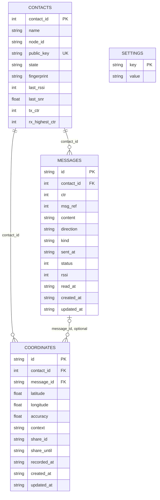

# Datenmodell

Stand: **nach T04 und T23**. Die App speichert ihre Nutzdaten auf Android in der SQLite-Datenbank `offgrid`. Im Browser tritt
an ihre Stelle eine gleichwertige Implementierung im Arbeitsspeicher. Beide Varianten verwenden dieselben
abstrakten Repositories.

## Beziehungen

Die Kontakte gehören der **Antenne**: sie besitzt die Schlüssel, die Zähler und die Kontaktliste. Die App spiegelt jeden Kontakt (ohne
Schlüssel), damit Verlauf und Anzeige auch ohne Antenne da sind. Es gibt keine Tabelle für das Pairing: das macht die Antenne.

## Schema und Migrationen

`src/app/core/data/migrations.ts` enthält die Migrationen in aufsteigender Versionsfolge. T04 legte Version 1 an; T23 hat sie einmalig
umgeschrieben (Schema ohne Kontaktschlüssel), weil es noch keine veröffentlichte App und keine Nutzerdaten gab. Wer ein altes Schema auf dem Handy
hat, deinstalliert die App.
`SqliteDatabaseService.open()` öffnet die Datenbank `offgrid` ohne Verschlüsselung, aktiviert mit
`PRAGMA foreign_keys = ON` die Fremdschlüssel und liest die gespeicherte Schema-Version aus `PRAGMA user_version`.
Jede neuere Migration läuft in einer Transaktion. Danach wird `PRAGMA user_version` auf die neue Version gesetzt.

Die Spalten heissen in SQLite `snake_case`, im TypeScript-Modell `camelCase`. Das Mapping liegt in
`src/app/core/data/sqlite-mapping.ts`. Laufzeitwerte werden mit `?` als Parameter gebunden. Nur die bereits geprüfte
Ganzzahl für `PRAGMA user_version` steht direkt im Statement.

## Tabellen

### `contacts`

| Feld | Typ | Regeln und Bedeutung |
|---|---|---|
| `contact_id` | `INTEGER` | Primärschlüssel: der Platz 1 bis 32 auf der Antenne, stabil, solange der Kontakt dort existiert. |
| `name` | `TEXT` | Nicht null, 1 bis 24 Zeichen. |
| `node_id` | `TEXT` | Nicht null, genau 4 Zeichen (Hex, Grossbuchstaben). |
| `public_key` | `TEXT` | Nicht null, genau 44 Zeichen (Base64 von 32 Bytes); eindeutiger Index. Ein **öffentlicher** Schlüssel. |
| `state` | `TEXT` | Nur `pending` oder `active`. `pending`, bis das erste gültige Paket des Gegenübers eintrifft. |
| `fingerprint` | `TEXT` | Nicht null; drei Vierergruppen, z. B. „0501 3010 7790“. Auf beiden Handys gleich. |
| `last_rssi` | `INTEGER` | Optionale Signalstärke des letzten gültigen Pakets. |
| `last_snr` | `REAL` | Optionales Signal-Rausch-Verhältnis. |
| `tx_ctr` | `INTEGER` | Nächster ausgehender Zähler, 0 bis 16777215 (nur zur Information). |
| `rx_highest_ctr` | `INTEGER` | Höchster geprüfter Zähler, den die Antenne empfangen hat; leer, wenn noch keiner. |

Es gibt **keine** Spalten für Sende- oder Empfangsschlüssel. Die Schlüssel eines Kontakts verlassen die Antenne nie.

### `messages`

| Feld | Typ | Regeln und Bedeutung |
|---|---|---|
| `id` | `TEXT` | Primärschlüssel, nicht null. |
| `contact_id` | `INTEGER` | Fremdschlüssel auf `contacts.contact_id`; Löschen des Kontakts löscht die Nachricht. |
| `ctr` | `INTEGER` | Zähler der Nachricht in der Unterhaltung (0 bis 16777215); bei ausgehenden Nachrichten erst nach der Antwort auf `msg.send` bekannt. |
| `msg_ref` | `INTEGER` | Lokaler Handle der Antenne für `msg.status`; nur bis zu ihrem nächsten Neustart gültig. |
| `content` | `TEXT` | Nicht null; bei einer Standort-Nachricht leer. |
| `direction` | `TEXT` | Nur `in` oder `out`. |
| `kind` | `TEXT` | Nur `text` oder `location`, Standard `text`. |
| `sent_at` | `TEXT` | Zeitpunkt, den die **App** setzt (die Antenne hat keine Uhr), nicht null. |
| `status` | `INTEGER` | 0 bis 3: queued, sent, delivered oder failed. |
| `rssi` | `INTEGER` | Optionale Signalstärke. |
| `read_at` | `TEXT` | Optionaler Zeitpunkt, an dem die Nachricht gelesen wurde. |
| `created_at` | `TEXT` | Erstellungszeitpunkt, nicht null. |
| `updated_at` | `TEXT` | Optionaler Änderungszeitpunkt. |

Indizes: `messages(contact_id, sent_at)`, `messages(contact_id, direction, ctr)` und `messages(msg_ref)`.

Der Status der Antenne (`queued`, `sent`, `relayed`, `retrying`, `delivered`, `failed`, `cancelled`) wird auf die vier Werte abgebildet:
`queued` → 0, `sent`/`relayed`/`retrying` → 1, `delivered` → 2, `failed`/`cancelled` → 3.

### `coordinates`

| Feld | Typ | Regeln und Bedeutung |
|---|---|---|
| `id` | `TEXT` | Primärschlüssel, nicht null. |
| `contact_id` | `INTEGER` | Fremdschlüssel auf `contacts.contact_id`; Löschen des Kontakts löscht die Koordinate. |
| `message_id` | `TEXT` | Optionaler Fremdschlüssel auf `messages.id`; Löschen der Nachricht löscht die Koordinate. |
| `latitude` | `REAL` | Nicht null, zwischen -90 und 90. |
| `longitude` | `REAL` | Nicht null, zwischen -180 und 180. |
| `accuracy` | `REAL` | Optionale Genauigkeit. |
| `context` | `TEXT` | Nur `einmal` oder `live`, Standard `einmal`. |
| `share_id` | `TEXT` | Optionale Id einer Standortfreigabe. |
| `share_until` | `TEXT` | Optionaler Zeitpunkt, bis zu dem die Freigabe läuft. |
| `recorded_at` | `TEXT` | Aufnahmezeitpunkt, nicht null. |
| `created_at` | `TEXT` | Erstellungszeitpunkt, nicht null. |
| `updated_at` | `TEXT` | Optionaler Änderungszeitpunkt. |

Index: `coordinates(message_id, recorded_at)`.

### `settings`

| Feld | Typ | Regeln und Bedeutung |
|---|---|---|
| `key` | `TEXT` | Primärschlüssel, nicht null. |
| `value` | `TEXT` | Nicht null. |

Gespeicherte Schlüssel sind `install_id`, `display_name`, `onboarding_done`, `bg_receive` und `vibrate`.

## Löschregeln und Gesamtoperationen

SQLite verwendet `ON DELETE CASCADE`: Beim Löschen eines Kontakts verschwinden seine Nachrichten und Koordinaten.
Beim Löschen einer Nachricht verschwinden ihre Koordinaten. Die Memory-Repositories bilden dieselbe Kaskade ab.

`DatabaseService.replaceAll(data)` ersetzt die Nutzdaten in einer Transaktion. Es werden zuerst Koordinaten,
Nachrichten und Kontakte gelöscht und danach die übergebenen Datensätze wieder eingefügt. Anschliessend
wird `display_name` in den Einstellungen gesetzt; die übrigen Einstellungen bleiben erhalten.

`DatabaseService.deleteAllUserData()` löscht Koordinaten, Nachrichten und Kontakte. Die Einstellungen
bleiben erhalten.

## Browser-Daten und Demo-Daten

Die Memory-Implementierungen speichern ihre Datensätze in `Map`s. Sie starten leer und verwenden dieselbe Sortierung
und dieselben Filter wie die SQLite-Implementierungen.

`MemoryDatabaseService.seedDemo()` füllt die Browser-Datenbank mit vier Kontakten (Anna Meier, Luca Bernasconi, Mia Frei und der noch
ausstehende Jonas Keller) und sechs Nachrichten. Der Seed enthält keine Standortdaten. Die Demo-Einstellungen sind
`install_id = 'demo-install-id'`, `display_name = 'HolyG'`, `onboarding_done = '1'`, `bg_receive = '1'` und `vibrate = '0'`.
Die Kontakte stehen in `DEMO_CONTACTS` (`memory/seed.ts`) mit festen, erfundenen öffentlichen Schlüsseln und Fingerabdrücken; das simulierte Gerät
kennt dieselben Kontakte, sonst ersetzt die Synchronisation sie beim Verbinden.

Der App-Start ruft `seedDemo()` nur im Browser und nur auf, wenn `localStorage.getItem('og.noseed') !== '1'`.
