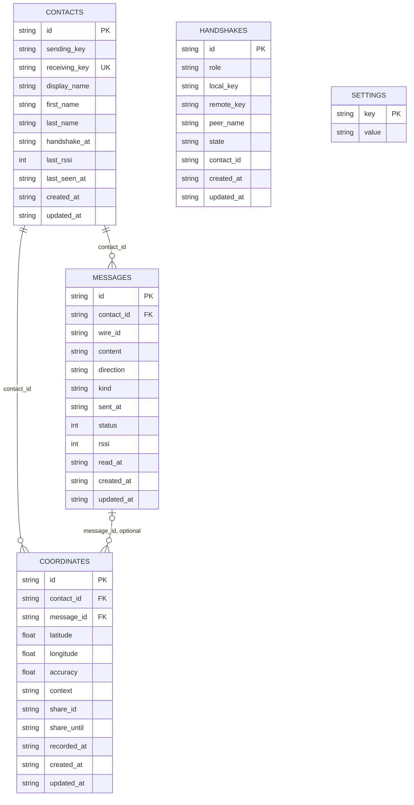

# Datenmodell

Stand: **nach T04**. Die App speichert ihre Nutzdaten auf Android in der SQLite-Datenbank `offgrid`. Im Browser tritt
an ihre Stelle eine gleichwertige Implementierung im Arbeitsspeicher. Beide Varianten verwenden dieselben
abstrakten Repositories.

## Beziehungen

## Schema und Migrationen

`src/app/core/data/migrations.ts` enthält die Migrationen in aufsteigender Versionsfolge. T04 legt Version 1 an.
`SqliteDatabaseService.open()` öffnet die Datenbank `offgrid` ohne Verschlüsselung, aktiviert mit
`PRAGMA foreign_keys = ON` die Fremdschlüssel und liest die gespeicherte Schema-Version aus `PRAGMA user_version`.
Jede neuere Migration läuft in einer Transaktion. Danach wird `PRAGMA user_version` auf die neue Version gesetzt.

Die Spalten heissen in SQLite `snake_case`, im TypeScript-Modell `camelCase`. Das Mapping liegt in
`src/app/core/data/sqlite-mapping.ts`. Laufzeitwerte werden mit `?` als Parameter gebunden. Nur die bereits geprüfte
Ganzzahl für `PRAGMA user_version` steht direkt im Statement.

## Tabellen

### `contacts`

| Feld | Typ | Regeln und Bedeutung |
|---|---|---|
| `id` | `TEXT` | Primärschlüssel, nicht null. |
| `sending_key` | `TEXT` | Nicht null, genau 32 Zeichen. |
| `receiving_key` | `TEXT` | Nicht null, genau 32 Zeichen; eindeutiger Index. |
| `display_name` | `TEXT` | Nicht null, 1 bis 100 Zeichen. |
| `first_name` | `TEXT` | Optional, höchstens 100 Zeichen. |
| `last_name` | `TEXT` | Optional, höchstens 100 Zeichen. |
| `handshake_at` | `TEXT` | Zeitpunkt des Handshakes, nicht null. |
| `last_rssi` | `INTEGER` | Optionale Signalstärke. |
| `last_seen_at` | `TEXT` | Optionaler Zeitpunkt des letzten Empfangs. |
| `created_at` | `TEXT` | Erstellungszeitpunkt, nicht null. |
| `updated_at` | `TEXT` | Optionaler Änderungszeitpunkt. |

### `messages`

| Feld | Typ | Regeln und Bedeutung |
|---|---|---|
| `id` | `TEXT` | Primärschlüssel, nicht null. |
| `contact_id` | `TEXT` | Fremdschlüssel auf `contacts.id`; Löschen des Kontakts löscht die Nachricht. |
| `wire_id` | `TEXT` | Nicht null, genau 8 Zeichen. |
| `content` | `TEXT` | Nicht null; bei einer Standort-Nachricht leer. |
| `direction` | `TEXT` | Nur `in` oder `out`. |
| `kind` | `TEXT` | Nur `text` oder `location`, Standard `text`. |
| `sent_at` | `TEXT` | Sendezeitpunkt, nicht null. |
| `status` | `INTEGER` | 0 bis 3: queued, sent, delivered oder failed. |
| `rssi` | `INTEGER` | Optionale Signalstärke. |
| `read_at` | `TEXT` | Optionaler Zeitpunkt, an dem die Nachricht gelesen wurde. |
| `created_at` | `TEXT` | Erstellungszeitpunkt, nicht null. |
| `updated_at` | `TEXT` | Optionaler Änderungszeitpunkt. |

Indizes: `messages(contact_id, sent_at)` und `messages(contact_id, wire_id)`.

### `coordinates`

| Feld | Typ | Regeln und Bedeutung |
|---|---|---|
| `id` | `TEXT` | Primärschlüssel, nicht null. |
| `contact_id` | `TEXT` | Fremdschlüssel auf `contacts.id`; Löschen des Kontakts löscht die Koordinate. |
| `message_id` | `TEXT` | Optionaler Fremdschlüssel auf `messages.id`; Löschen der Nachricht löscht die Koordinate. |
| `latitude` | `REAL` | Nicht null, zwischen -90 und 90. |
| `longitude` | `REAL` | Nicht null, zwischen -180 und 180. |
| `accuracy` | `REAL` | Optionale Genauigkeit. |
| `context` | `TEXT` | Nur `einmal` oder `live`, Standard `einmal`. |
| `share_id` | `TEXT` | Optionale Id einer Standortfreigabe. |
| `share_until` | `TEXT` | Optionaler Zeitpunkt, bis zu dem die Freigabe läuft. |
| `recorded_at` | `TEXT` | Aufnahmezeitpunkt, nicht null. |
| `created_at` | `TEXT` | Erstellungszeitpunkt, nicht null. |
| `updated_at` | `TEXT` | Optionaler Änderungszeitpunkt. |

Index: `coordinates(message_id, recorded_at)`.

### `handshakes`

| Feld | Typ | Regeln und Bedeutung |
|---|---|---|
| `id` | `TEXT` | Primärschlüssel, nicht null. |
| `role` | `TEXT` | Nur `shower` oder `scanner`. |
| `local_key` | `TEXT` | Nicht null, genau 32 Zeichen. |
| `remote_key` | `TEXT` | Optionaler Schlüssel des Gegenübers. |
| `peer_name` | `TEXT` | Optionaler Name des Gegenübers. |
| `state` | `TEXT` | Nur `waiting`, `sent`, `done` oder `cancelled`. |
| `contact_id` | `TEXT` | Optionale Kontakt-Id; im Schema ohne Fremdschlüssel-Constraint. |
| `created_at` | `TEXT` | Erstellungszeitpunkt, nicht null. |
| `updated_at` | `TEXT` | Optionaler Änderungszeitpunkt. |

### `settings`

| Feld | Typ | Regeln und Bedeutung |
|---|---|---|
| `key` | `TEXT` | Primärschlüssel, nicht null. |
| `value` | `TEXT` | Nicht null. |

Gespeicherte Schlüssel sind `install_id`, `display_name`, `onboarding_done`, `bg_receive` und `vibrate`.

## Löschregeln und Gesamtoperationen

SQLite verwendet `ON DELETE CASCADE`: Beim Löschen eines Kontakts verschwinden seine Nachrichten und Koordinaten.
Beim Löschen einer Nachricht verschwinden ihre Koordinaten. Die Memory-Repositories bilden dieselbe Kaskade ab.

`DatabaseService.replaceAll(data)` ersetzt die Nutzdaten in einer Transaktion. Es werden zuerst Koordinaten,
Nachrichten, Kontakte und Handshakes gelöscht und danach die übergebenen Datensätze wieder eingefügt. Anschliessend
wird `display_name` in den Einstellungen gesetzt; die übrigen Einstellungen bleiben erhalten.

`DatabaseService.deleteAllUserData()` löscht Koordinaten, Nachrichten, Kontakte und Handshakes. Die Einstellungen
bleiben erhalten.

## Browser-Daten und Demo-Daten

Die Memory-Implementierungen speichern ihre Datensätze in `Map`s. Sie starten leer und verwenden dieselbe Sortierung
und dieselben Filter wie die SQLite-Implementierungen.

`MemoryDatabaseService.seedDemo()` füllt die Browser-Datenbank mit drei Kontakten (Anna Meier, Luca Bernasconi und
Mia Frei), sechs Nachrichten und dem offenen Handshake „Jonas Keller“. Der Seed enthält keine Standortdaten. Die
Demo-Einstellungen sind `install_id = 'demo-install-id'`, `display_name = 'HolyG'`,
`onboarding_done = '1'`, `bg_receive = '1'` und `vibrate = '0'`. Die Schlüssel der Demo-Kontakte werden neu erzeugt.

Der App-Start ruft `seedDemo()` nur im Browser und nur auf, wenn `localStorage.getItem('og.noseed') !== '1'`.
