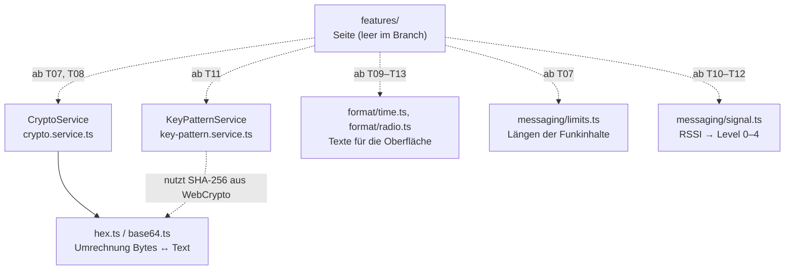
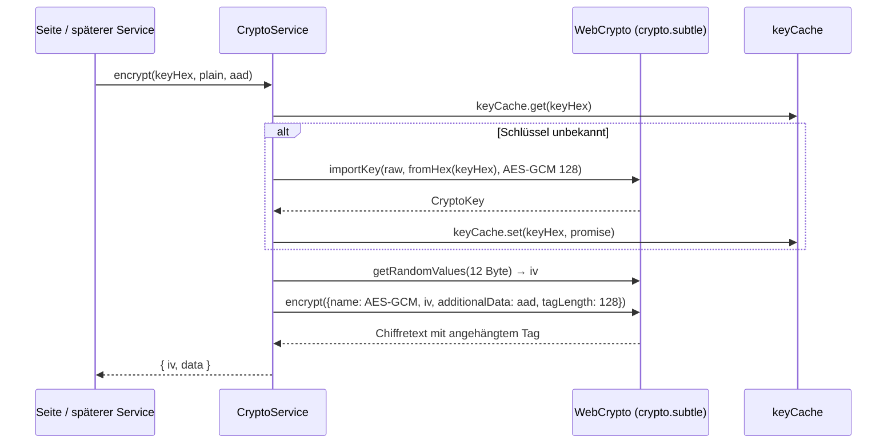

# Services

`src/app/core/` enthält die Logik ohne Oberfläche. Dort gibt es zwei Arten von Bausteinen:

- **Services** – Angular-Klassen mit `@Injectable({ providedIn: 'root' })`. Zustand liegt als `signal()`, abgeleitet
  mit `computed()`; Seiten lesen nur Signals.
- **Hilfsfunktionen** – exportierte Funktionen ohne Zustand, ohne Angular. Sie rechnen oder formatieren und werden von
  Services und Seiten direkt aufgerufen.

Stand: **nach T03** (Zeitformate, Krypto-Basis, Schlüssel-Muster, Signal-Level). Alle übrigen Dienste sind noch nicht
gebaut.



Die gestrichelten Kanten sind geplant: Auf diesem Branch ruft noch keine Seite einen dieser Bausteine auf, weil alle
Seiten noch leere Gerüste sind.

## CryptoService

`src/app/core/crypto/crypto.service.ts` – Krypto ausschliesslich über **WebCrypto** (`crypto.subtle`), ohne
zusätzliche Pakete. Der Service hält keinen Zustand, den die Oberfläche liest; er cacht nur abgeleitete Werte.

| Name | Typ | Beschreibung |
|---|---|---|
| `newKey()` | `string` | 16 Zufallsbytes als **32 Zeichen Kleinbuchstaben-Hex**. Länge passt zu `CHAR(32)` im Datenmodell. |
| `randomHex(bytes)` | `string` | Zufallsbytes als Hex, z. B. 4 Byte für eine `wireId`. |
| `tag(keyHex)` | `Promise<string>` | Erste 4 Byte von **SHA-256** über die 16 Rohbytes des Schlüssels, als 8 Hex-Zeichen. Wird pro Schlüssel gecacht. |
| `encrypt(keyHex, plain, aad)` | `Promise<{ iv; data }>` | **AES-GCM** mit 128-Bit-Tag, 12 Byte IV und 128 Bit Authentifizierungs-Tag. Pro Aufruf ein neuer IV. `aad` wird nicht mitverschlüsselt, aber authentifiziert. |
| `decrypt(keyHex, iv, data, aad)` | `Promise<Uint8Array>` | Entschlüsselt. Wirft bei falschem Schlüssel, anderer AAD oder beschädigtem Ciphertext. |

Intern, nicht öffentlich: `cryptoKey()` importiert den Schlüssel einmalig (`extractable: false`, nur `encrypt` und
`decrypt`) und merkt sich das Versprechen im `keyCache`; `webCryptoBytes()` kopiert einen `Uint8Array`, wenn er auf
einem `SharedArrayBuffer` liegt, weil WebCrypto nur Bytes an einem `ArrayBuffer` annimmt.



## KeyPatternService

`src/app/core/crypto/key-pattern.service.ts` – macht aus Schlüsseln das **Schlüssel-Muster**, das als Profilbild
dient. Das Muster ist ein **5 × 5 Raster**, spiegelsymmetrisch: Für jede Zeile werden nur 3 Byte der linken Hälfte
gelesen, die rechte Hälfte ist die Spiegelung.

| Name | Typ | Beschreibung |
|---|---|---|
| `forContact(contact)` | `Promise<boolean[]>` | Muster eines Kontakts: `sendingKey` und `receivingKey` **sortiert** aneinandergehängt, als UTF-8 durch SHA-256. 25 Werte, je Zelle `true` = gesetzt. |
| `forInstall(installId)` | `Promise<boolean[]>` | Eigenes Muster aus der Einstellung `install_id` (Einstellungen-Seite, Leerzustand). |

```ts
// src/app/core/crypto/key-pattern.service.ts
for (let zeile = 0; zeile < ZEILEN; zeile += 1) {
  for (let spalte = 0; spalte < ZEILEN; spalte += 1) {
    // Spalte 3 = Spalte 1, Spalte 4 = Spalte 0.
    const index = spalte < SPALTEN_LINKS ? spalte : ZEILEN - 1 - spalte;
    zellen.push((bytes[zeile * SPALTEN_LINKS + index] & 1) === 1);
  }
}
```

Damit sieht das Muster unabhängig davon, wer welchen Schlüssel hat, gleich aus. Ist das Bild fast leer (weniger als
5 gesetzte Zellen), setzt der Service zusätzlich die Mitte und die Zellen links und rechts in der zweiten Zeile – so
ist nie ein fast leeres Profilbild zu sehen. Ergebnisse werden pro Eingabe gecacht; der Aufrufer bekommt immer eine
Kopie der Liste, nicht die gecachte.

## Hilfsfunktionen ohne Zustand

### `core/format/time.ts` – Zeit- und Datumsformate

Alle Formate laufen über `Intl.DateTimeFormat('de-CH', …)` in der Zeitzone `Europe/Zurich`. Die Seiten übergeben
`new Date()` als `now`; heute, gestern und „innerhalb von 7 Tagen“ werden über den **Kalendertag in dieser Zeitzone**
entschieden, damit eine Nachricht knapp nach Mitternacht UTC noch richtig eingeordnet wird.

| Name | Typ | Beschreibung |
|---|---|---|
| `formatTime(iso)` | `string` | `HH:mm` im 24-Stunden-Format. |
| `formatListTime(iso, now)` | `string` | Listenzeit: heute `HH:mm`, gestern „Gestern“, unter 7 Tagen der kurze Wochentag („Mo.“), sonst `dd.MM.yy`. |
| `formatLastSeen(iso, now)` | `string` | „zuletzt 14:32“, „zuletzt gestern“, „zuletzt 21.10.“ oder „noch nie empfangen“ bei `null`. |
| `formatDay(iso, now)` | `string` | Tagestrenner im Chat: „HEUTE“, „GESTERN“ oder `dd.MM.yyyy`. |

### `core/format/radio.ts` – Funkwerte

| Name | Typ | Beschreibung |
|---|---|---|
| `formatMHz(freqHz)` | `string` | Frequenz in MHz als Text, z. B. `868100000` → „868“. Rundet immer ab, nie auf. |

### `core/crypto/hex.ts` – Hex

| Name | Typ | Beschreibung |
|---|---|---|
| `toHex(bytes)` | `string` | Bytes als Kleinbuchstaben-Hex mit führender Null, z. B. `[0, 255]` → „00ff“. |
| `fromHex(hex)` | `Uint8Array` | Hex zu Bytes. Wirft bei ungerader Länge oder Zeichen ausserhalb von `0–9`/`a–f` (Fehler `invalid-hex`). |

### `core/crypto/base64.ts` – Base64

Wird für das Feld `p` im Serial-Protokoll (`tx`/`rx`) gebraucht.

| Name | Typ | Beschreibung |
|---|---|---|
| `toBase64(bytes)` | `string` | Bytes als Base64-Text, in Blöcken von 0x8000 Byte, damit auch grosse Frames nicht den Aufruf-Stack sprengen. |
| `fromBase64(text)` | `Uint8Array` | Base64-Text zu Bytes. |

### `core/messaging/limits.ts` – Längen der Funkinhalte

| Name | Typ | Beschreibung |
|---|---|---|
| `contentBytes(text)` | `number` | Platz, den der Text im Klartext-JSON braucht. Die zwei Anführungszeichen zählen nicht mit. |
| `maxContentBytes(max)` | `number` | Grösster Text, der noch in einen Frame passt: 33 Byte Frame-Overhead + 36 Byte JSON-Hülle, gedeckelt bei 180 Byte. |
| `isValidDisplayName(name)` | `boolean` | Anzeigename: höchstens 40 Zeichen **und** höchstens 60 Byte, damit `hs`-Frames immer passen. |

```ts
// src/app/core/messaging/limits.ts
export function maxContentBytes(max: number): number {
  return Math.min(180, max - 69);
}
```

### `core/messaging/signal.ts` – Signalstärke

| Name | Typ | Beschreibung |
|---|---|---|
| `signalLevel(rssi, seenAt, now)` | `0 \| 1 \| 2 \| 3 \| 4` | Level für die Komponente `og-signal-bars`. Nie gesehen, kein RSSI oder älter als 15 Minuten ergibt 0. |
| `signalLabel(level)` | `string` | Text für das `aria-label` von `og-signal-bars`. |

```ts
// src/app/core/messaging/signal.ts
if (rssi >= -80) {
  return 4;
}
if (rssi >= -95) {
  return 3;
}
if (rssi >= -105) {
  return 2;
}
if (rssi >= -115) {
  return 1;
}
return 0;
```

| RSSI in dBm (frisch, letzte 15 Minuten) | Level | `signalLabel` |
|---|---|---|
| ab −80 | 4 | Signal sehr gut |
| ab −95 | 3 | Signal gut |
| ab −105 | 2 | Signal mittel |
| ab −115 | 1 | Signal schwach |
| darunter, kein RSSI, nie gesehen oder älter als 15 Minuten | 0 | Ausser Reichweite |

## Noch nicht gebaut

| Baustein | Ticket |
|---|---|
| Repositories, Datenbank im Speicher, Einstellungen, App-Start | T04 |
| `AntennaPort`, Frame-Codec, Mock-Antenne | T05 |
| `SerialAntennaService` | T06 |
| `MessagingService` mit Warteschlange und Zustellstatus | T07 |
| `HandshakeService` | T08 |
| `BackupService` | T14 |
| `LocationService` | T17 |
| `GroupService` | T20 (optional) |