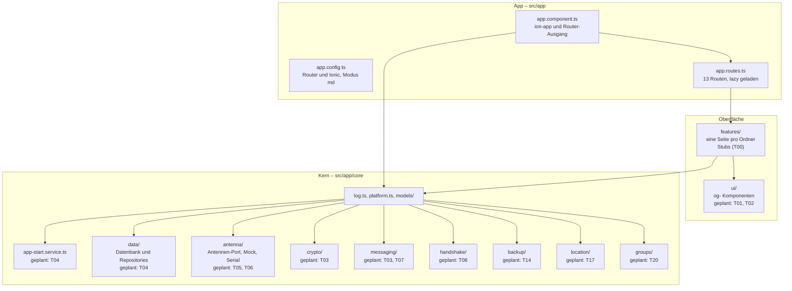

# Überblick

Stand: **nach T00** (Projektgerüst und Theme). Gebaut sind das App-Gerüst, die Kern-Grundlagen (`log.ts`,
`platform.ts`, `models/`) und das Theme. Die Seiten unter `features/` sind leere Stubs; ihr Inhalt kommt mit dem
jeweiligen Ticket. Alles, was noch fehlt, trägt im Diagramm und im Ordnerbaum den Vermerk „geplant: Txx".

## Schichten



Der Vermerk „geplant: Txx" bedeutet: Der Teil ist noch nicht gebaut und wird im genannten Ticket umgesetzt.
Knoten ohne diesen Vermerk existieren bereits auf dem aktuellen Branch.

## Ordnerstruktur

```
src/
  app/
    app.component.ts          ion-app mit ion-router-outlet
    app.config.ts             Provider (Router, Ionic)
    app.routes.ts             Routen
    core/
      log.ts                  log.debug/info/warn/error
      platform.ts             isNative(), STATUS_BAR_COLOR
      models/                 antenna, contact, errors, handshake, message, settings
      app-start.service.ts    geplant: T04
      antenna/                geplant: T05, T06
      backup/                 geplant: T14
      crypto/                 geplant: T03
      data/                   geplant: T04
      format/                 geplant: T03
      groups/                 geplant: T20
      handshake/              geplant: T08
      location/               geplant: T17
      messaging/              geplant: T03, T07
      settings/               geplant: T04
    features/
      chat/                   geplant: T12
      einstellungen/          geplant: T13, T14
      gruppe/                 geplant: T20
      handshake/              geplant: T11
      kontakte/               geplant: T10
      name/                   geplant: T09
      standort/               geplant: T18
      verbinden/              geplant: T09
    ui/                       geplant: T01, T02
  environments/               environment.ts, environment.prod.ts
  theme/                      tokens.scss, typography.scss, global.scss
  test-setup.ts               WebCrypto für Vitest und jsdom
  index.html                  lang="de", Titel "OffGrid"
  main.ts
```

## Schichten im Detail

| Schicht | Ort | Aufgabe | Stand |
|---|---|---|---|
| App | `src/app/app.*.ts` | Wurzel-Komponente, Provider, Routen | fertig (T00) |
| Oberfläche | `src/app/features/`, `src/app/ui/` | Screens und wiederverwendbare `og-`-Komponenten | Stubs (T00), gefüllt ab T01, T02, T09 |
| Kern | `src/app/core/` | Services ohne Oberfläche: Daten, Antenne, Krypto, Messaging | Grundgerüst (T00), gefüllt ab T03 |
| Typen | `src/app/core/models/` | Kontakt, Nachricht, Handshake, Antenne, Settings, Fehlercodes | fertig (T00) |
| Theme | `src/theme/` | Design-Tokens, Schriften, globales Styling | fertig (T00) |

## Plattform-Weiche

`src/app/core/platform.ts` liefert `isNative()` über `Capacitor.isNativePlatform()`:

- **Im Browser** (`npm start`): `isNative()` ist `false`. Es gibt kein Android und keine Antenne.
- **Auf Android**: `isNative()` ist `true`. Statusleiste und Splash-Screen setzt der App-Start (geplant: T04).

Die Weiche auf der Provider-Ebene ist noch nicht gebaut. Geplant ist:

| Browser | Android |
|---|---|
| `MockAntennaService` | `SerialAntennaService` (T05, T06) |
| `MemoryDatabaseService` und Memory-Repositories | SQLite-Repositories (T04) |

Zusätzlich gilt: Ist `localStorage.getItem('og.mock') === '1'`, wird auch auf Android die Mock-Antenne benutzt. Das
Einstellen und Zurücksetzen passiert nur über die Entwickler-Konsole, es gibt dafür keine Oberfläche.

## Konventionen

- Nur Standalone-Komponenten, `ChangeDetectionStrategy.OnPush`, Abhängigkeiten mit `inject()`.
- Zustand in Services als `signal()`, abgeleitet mit `computed()`. Die App ist zoneless: jede asynchrone Änderung
  schreibt in ein Signal.
- Ionic-Komponenten nur als Rahmen (`ion-app`, `ion-router-outlet`, `ion-header`, `ion-content`, `ion-footer`).
  Alles Sichtbare sind eigene `og-`-Komponenten.
- Farben und Grössen kommen ausschliesslich aus den Tokens in `src/theme/tokens.scss`.
- Alle sichtbaren Texte sind Deutsch (Schweiz).

Siehe dazu auch [Services](services.md), [Datenmodell](datenmodell.md) und [CI](../qualitaet/ci.md).
