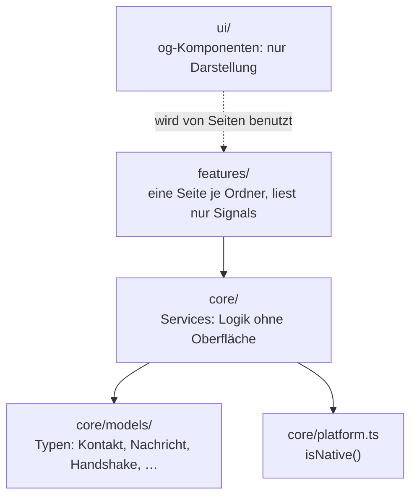

# Überblick

Stand: **nach T00** (Projekt-Setup und Theme) und **T03** (Zeitformate, Krypto-Basis, Schlüssel-Muster, Signal-Level).
Alles Weitere ist geplant.

## Schichten



- `core/` ist für alles da, was ohne Bildschirm funktioniert. Auf diesem Branch stehen dort `log.ts`, `platform.ts`,
  die Typen in `core/models/` sowie aus T03 `format/`, `crypto/` und `messaging/`; die Dienste für Antenne, Daten,
  Nachrichten, Handshake, Backup, Standort und Einstellungen kommen später (siehe „Geplant, noch nicht im Branch“
  weiter unten).
- `ui/` ist für wiederverwendbare `og-`-Komponenten gedacht, die keine Services kennen (ab T01, T02).
- `features/` enthält die Seiten. Jede Seite gehört in einen eigenen Ordner und heisst `<name>.page.ts`.
- `core/platform.ts` entscheidet, ob die App nativ auf Android läuft oder im Browser.

## Ordnerstruktur

```text
src/
  app/
    app.config.ts        Provider: Router, Ionic (md)
    app.routes.ts        Routen, jede Seite lazy via loadComponent
    app.component.ts     <ion-app><ion-router-outlet/></ion-app>
    core/
      log.ts             Logging (log.debug/info/warn/error)
      platform.ts        isNative(), STATUS_BAR_COLOR
      models/            antenna, contact, errors, handshake, message, settings
      format/            time.ts, radio.ts – Zeit- und Funktexte (T03)
      crypto/            hex.ts, base64.ts, CryptoService, KeyPatternService (T03)
      messaging/         limits.ts, signal.ts – Textlängen, Signal-Level (T03)
    features/
      verbinden/ name/ kontakte/ handshake/ chat/ standort/
      einstellungen/ gruppe/
  theme/
    tokens.scss          Design-Tokens (Farben, Radien, Grössen)
    typography.scss      Schriften
    global.scss          globales Ionic-Mapping
  environments/          environment.ts / environment.prod.ts
  index.html             lang="de", Titel "OffGrid"
  test-setup.ts          WebCrypto für Vitest/jsdom
```

Geplant, noch nicht im Branch (jeweils mit Ticket-Stand, siehe [Start](../index.md)):

```text
core/
  data/                 Datenbank, Repositories, Memory-Implementierung (T04)
  antenna/              AntennaPort, NDJSON, Serial- und Mock-Antenne (T05, T06)
  messaging/            zusätzlich: Frame-Codec, MessagingService (T05, T07)
  handshake/            HandshakeService, QR-Scanner (T08, T11)
  backup/               BackupService, Datei-I/O (T14)
  location/             Geo-Funktionen, LocationService, Karten (T17, T18)
  groups/               GroupService (nur T20)
  app-start.service.ts  DB öffnen, Settings, Antenne verbinden (T04)
  onboarding.guard.ts   Guard aufs Onboarding (T09)
```

## Konventionen

- Nur Standalone-Komponenten, `ChangeDetectionStrategy.OnPush`, Abhängigkeiten mit `inject()`.
- Zustand liegt als `signal()` in den Services, abgeleitet mit `computed()`. Seiten lesen nur Signals.
- Die App ist **zoneless**: jede asynchrone Änderung schreibt in ein Signal, sonst aktualisiert sich nichts.
- Templates mit `@if`, `@for`, `@switch`.
- Ionic liefert nur `ion-app`, `ion-router-outlet`, `ion-header`, `ion-content`, `ion-footer`. Alles Sichtbare
  darüber hinaus sind `og-`-Komponenten.

## Plattform-Weiche

`isNative()` in `src/app/core/platform.ts` kapselt `Capacitor.isNativePlatform()`. Das ist auf diesem Branch der
ganze Teil der Weiche:

```ts
// src/app/core/platform.ts
export function isNative(): boolean {
  return Capacitor.isNativePlatform();
}
```

`app.config.ts` trägt heute nur Router und Ionic. Die Auswahl der Implementierungen fehlt noch.

!!! info "Geplant"
    Die Weiche entsteht ab **T04** (SQLite nativ, Datenbank im Speicher im Browser mit Demo-Daten), **T05**
    (Mock-Antenne) und **T06** (`SerialAntennaService` mit USB-Serial-Plugin). In `app.config.ts` wird dann für
    jeden Baustein die native oder die Browser-Implementierung als Provider eingetragen; Repositories sind dabei
    abstrakte Klassen, Sqlite- und Memory-Implementierung teilen sich denselben Datenbestand.

    Ab **T06** gilt zusätzlich: Ist `localStorage.getItem('og.mock') === '1'`, läuft die App auch auf Android mit
    der Mock-Antenne. Ein- und Ausschalten nur über die Entwickler-Konsole, ohne Bedienelement in der App.

    Zielbild:

    ```mermaid
    flowchart TD
      Q{"isNative()"} -->|"ja"| SERIAL["SerialAntennaService<br/>SQLite"]
      Q -->|"nein"| MOCK["MockAntennaService<br/>Memory-Datenbank"]
      SERIAL --> EXTRA["localStorage og.mock === '1'<br/>→ trotzdem Mock (Vorführung ohne Hardware)"]
      MOCK --> EXTRA
      EXTRA --> BROWSER["Browser: Demo-Daten aus der<br/>Memory-Datenbank seeden"]
    ```

## Routen

`src/app/app.routes.ts` – jede Seite wird lazy über `loadComponent` geladen. `''` leitet auf `kontakte` um.

| Pfad | Seite |
|---|---|
| `''` | Umleitung auf `kontakte` |
| `verbinden` | VerbindenPage |
| `name` | NamePage |
| `kontakte` | KontaktePage |
| `kontakte/neu` | HandshakePage |
| `kontakte/neu/fertig/:contactId` | KontaktBenennenPage |
| `chat/:contactId` | ChatPage |
| `chat/:contactId/standort/:messageId` | StandortPage |
| `gruppe/neu` | GruppeNeuPage |
| `gruppe/:groupId` | GruppeChatPage |
| `einstellungen` | EinstellungenPage |
| `einstellungen/export` | ExportPage |
| `einstellungen/import` | ImportPage |

Die Seiten sind im Branch T00 noch leere Gerüste (`<ion-content></ion-content>`). Inhalt, Texte und Zustände
stehen im Skill `offgrid-screens` und werden mit den Tickets T09–T14 umgesetzt.