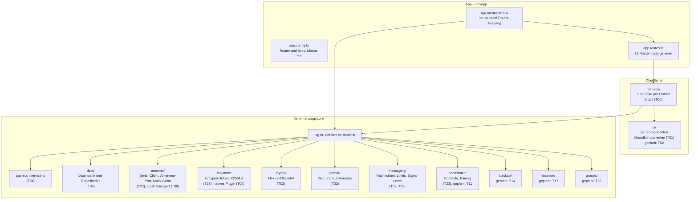

# Überblick

Stand: **nach T01, T03, T04, T06, T23** (Projektgerüst, Theme, og-Grundkomponenten, Zeitformate, Datenbank, native Anbindung an die Antenne,
Host-API zur Antenne). Gebaut sind
das App-Gerüst, die Kern-Grundlagen (`log.ts`, `platform.ts`, `models/`), das Theme, die 13 Grundkomponenten in `src/app/ui/`, die
Daten-Schicht, der Serial-Client mit Antennen-Port und Mock-Gerät, der Entsperr-Schlüssel, die native USB-Serial-Anbindung für Android sowie
die Nachrichten- und Kontaktdienste.
Die Seiten unter `features/` sind leere Stubs; ihr Inhalt kommt mit dem jeweiligen Ticket. Alles, was noch fehlt, trägt im Diagramm und im
Ordnerbaum den Vermerk „geplant: Txx".

**Aufgabenteilung:** Die Antenne (Heltec V3) besitzt Identität, Kontaktschlüssel, Verschlüsselung, Zähler und Kontaktliste. Die App ist
Oberfläche und Verlaufsspeicher; sie schickt Klartext über die Host-API und hält nur das Entsperr-Geheimnis im Android Keystore.

## Schichten



Der Vermerk „geplant: Txx" bedeutet: Der Teil ist noch nicht gebaut und wird im genannten Ticket umgesetzt.
Knoten ohne diesen Vermerk existieren bereits auf dem aktuellen Branch.

## Ordnerstruktur

```
src/
  app/
    app.component.ts          ion-app mit ion-router-outlet
    app.config.ts             Provider (Router, Ionic)
    app.routes.ts             Routen
    core/
      log.ts                  log.debug/info/warn/error
      platform.ts             isNative(), STATUS_BAR_COLOR
      models/                 antenna, contact, device, errors, handshake, message, settings
      app-start.service.ts    Datenbank, Einstellungen, Antenne starten (T04, T23)
      antenna/                Serial-Client, Antennen-Port, Mock-Gerät (T23), USB-Transport (T06)
      backup/                 geplant: T14
      crypto/                 Hex, Base64 (T03)
      data/                   Datenbank und Repositories (T04, T23)
      format/                 Zeit- und Funkformate (T03)
      groups/                 geplant: T20
      handshake/              Kontakte spiegeln, Pairing (T23), Scanner geplant: T11
      keystore/               Entsperr-Token, X25519, Wrap (T23), natives Plugin (T06)
      location/               geplant: T17
      messaging/              Limits, Signal-Level (T03), Nachrichten, Reaktionen (T23)
      settings/               Einstellungen (T04)
    features/
      chat/                   geplant: T12
      einstellungen/          geplant: T13, T14
      gruppe/                 geplant: T20
      handshake/              geplant: T11
      kontakte/               geplant: T10
      name/                   geplant: T09
      standort/               geplant: T18
      verbinden/              geplant: T09
    ui/                       og-Grundkomponenten (T01), geplant: T02
  environments/               environment.ts, environment.prod.ts
  theme/                      tokens.scss, typography.scss, global.scss
  test-setup.ts               WebCrypto für Vitest und jsdom
  index.html                  lang="de", Titel "OffGrid"
  main.ts
```

## Schichten im Detail

| Schicht | Ort | Aufgabe | Stand |
|---|---|---|---|
| App | `src/app/app.*.ts` | Wurzel-Komponente, Provider, Routen | fertig (T00) |
| Oberfläche | `src/app/features/`, `src/app/ui/` | Screens und wiederverwendbare `og-`-Komponenten | Grundkomponenten fertig (T01), Zustandskomponenten ab T02, Seiten ab T09 |
| Kern | `src/app/core/` | Services ohne Oberfläche: Daten, Antenne, Entsperr-Schlüssel, Messaging | Grundgerüst (T00), Formate (T03), Daten (T04), Antenne und Nachrichten (T23), native Plugins (T06) |
| Typen | `src/app/core/models/` | Kontakt, Nachricht, Antenne, Gerät (Host-API), Handshake-Fehler, Settings, Fehlercodes | fertig (T00, T23) |
| Theme | `src/theme/` | Design-Tokens, Schriften, globales Styling | fertig (T00) |

## Plattform-Weiche

`src/app/core/platform.ts` liefert `isNative()` über `Capacitor.isNativePlatform()`:

- **Im Browser** (`npm start`): `isNative()` ist `false`. Es gibt kein Android und keine Antenne.
- **Auf Android**: `isNative()` ist `true`. Statusleiste und Splash-Screen setzt der App-Start.

Die Weiche liegt in `app.config.ts` auf Provider-Ebene und betrifft nur die Leitung zur Antenne, den Entsperr-Schlüssel und die Daten:

| Token | Browser | Android |
|---|---|---|
| `SerialTransport` | `MockSerialTransport` (simuliertes Gerät) | `UsbSerialTransport` (T06, natives USB-Plugin) |
| `KeystoreService` | `BrowserKeystoreService` (Schlüssel im Arbeitsspeicher) | `AndroidKeystoreService` (T06, natives Keystore-Plugin) |
| `DatabaseService` und Repositories | Memory-Implementierungen | SQLite-Implementierungen |

`AntennaPort`, `SerialClient`, `MessagingService` und `HandshakeService` sind für beide Plattformen dieselben Klassen. Auf Android verbindet sich die
App nach einem `resume` erneut, wenn die Antenne `disconnected` ist (`src/app/app.config.ts`). Zusätzlich gilt: Ist
`localStorage.getItem('og.mock') === '1'`, laufen auch auf Android das simulierte Gerät und der Arbeitsspeicher-Schlüssel (Vorführen ohne
Hardware). Das Einstellen und Zurücksetzen passiert nur über die Entwickler-Konsole, es gibt dafür keine Oberfläche.

## Konventionen

- Nur Standalone-Komponenten, `ChangeDetectionStrategy.OnPush`, Abhängigkeiten mit `inject()`.
- Zustand in Services als `signal()`, abgeleitet mit `computed()`. Die App ist zoneless: jede asynchrone Änderung
  schreibt in ein Signal.
- Ionic-Komponenten nur als Rahmen (`ion-app`, `ion-router-outlet`, `ion-header`, `ion-content`, `ion-footer`).
  Alles Sichtbare sind eigene `og-`-Komponenten.
- Farben und Grössen kommen ausschliesslich aus den Tokens in `src/theme/tokens.scss`.
- Alle sichtbaren Texte sind Deutsch (Schweiz).

Siehe dazu auch [Services](services.md), [Datenmodell](datenmodell.md) und [CI](../qualitaet/ci.md).
