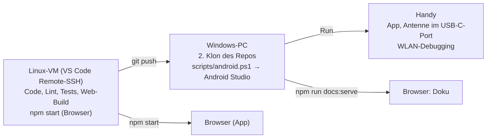

# Erste Schritte

OffGrid wird an drei Orten entwickelt und getestet. Die App entsteht auf der **VM**, auf dem **Handy** läuft sie
mit der echten Antenne.



## Entwicklungsumgebung

### VM (Code, Lint, Tests, Web-Build)

- **Node ≥ 24.15** (Angular 22 verlangt `^22.22.3 || ^24.15.0 || ^26`). Prüfen mit `node -v`.
- **Python ≥ 3.10** und `python3-venv`, nur für die Doku. Einmalig: `sudo apt install python3-venv`.
- Agents laufen dort; ein Android-SDK wird nicht gebraucht.
- Für die Doku einmalig: `npm run docs:install` (legt `.venv-docs/` an, lädt MkDocs Material).

### Windows (Android-Build)

- **Node 24 LTS** und **Git**.
- Repo ein zweites Mal klonen.
- PowerShell: einmalig `Set-ExecutionPolicy -Scope CurrentUser RemoteSigned`.
- **Android Studio** (2026.2.1). Gradle-JDK auf **JDK 21** stellen, sonst kommt „Unsupported class file major
  version“. Ein AGP-/Gradle-Upgrade ablehnen – Capacitor gibt die Versionen vor.
- Das Skript `scripts/android.ps1` holt `main`, baut, kopiert und öffnet Android Studio.
  Für einen Branch vor dem Merge: `.\scripts\android.ps1 -Branch feature/T12-screen-chat`.

### Handy

- Entwickleroptionen aktivieren, **Kabelloses Debugging** einschalten.
- In Android Studio über *Pair Devices Using Wi-Fi* koppeln. Der USB-C-Port ist von der Antenne belegt, darum
  läuft das Debugging über WLAN.
- Fehlersuche: Chrome `chrome://inspect` → WebView der OffGrid. Die App läuft als WebView, die Konsole verhält sich
  wie im Browser.

!!! info "Geplant"
    Ab **T06** kommen native Meldungen des USB-Serial-Plugins dazu. Sie stehen dann in Android Studio unter
    *Logcat* mit dem Filter `UsbSerial`.

## Befehle

| Zweck | Befehl |
|---|---|
| Dev-Server im Browser, Mock-Antenne und Demo-Daten ab T04/T05 | `npm start` |
| Lint | `npm run lint` |
| Tests einmal, headless | `npm run test:ci` |
| Produktions-Build | `npm run build` |
| Alle App-Checks wie in CI | `npm run check` |
| Doku einmalig einrichten | `npm run docs:install` |
| Doku bauen wie in CI | `npm run docs:build` |
| Doku ansehen (Port 8000) | `npm run docs:serve` |
| Screenshots der Screens | `npm run docs:screens` |
| Android synchronisieren | `npx cap sync android` |

## App im Browser ansehen

`npm start` auf der VM startet die App auf Port 4200; VS Code leitet den Port an den Windows-Browser weiter. Mit F12
das Gerätesymbol auf Handy-Grösse stellen.

!!! info "Geplant"
    Der Betrieb im Browser mit Mock-Antenne und Demo-Daten ist noch nicht gebaut. Ab **T04** läuft die App im
    Browser mit einer Datenbank im Speicher, die beim Start mit Demo-Daten gefüllt wird. Ab **T05** gibt es die
    Mock-Antenne mit den `window.ogMock`-Haken. Ab **T06** erzwingt der `localStorage`-Schlüssel `og.mock` die
    Mock-Antenne auch auf dem Handy.

    Die Antenne steuert man dann in der Browser-Konsole über `window.ogMock`:

    | Aufruf | Wirkung |
    |---|---|
    | `ogMock.receive('Anna Meier', 'Hallo')` | Eingehende Nachricht von Anna |
    | `ogMock.receiveLocation('Anna Meier')` | Eingehende Standort-Nachricht, ab **T17** |
    | `ogMock.completeShowing()` | QR-Handshake als Scanner abschliessen |
    | `ogMock.drop()` | Antenne fällt aus (`restore()` bringt sie zurück) |
    | `ogMock.failNext()` | Nächste Übertragung schlägt fehl |

    Leerzustand und Onboarding ohne Demo-Daten, ab **T04**:

    ```js
    localStorage.setItem('og.noseed', '1'); // zurück: localStorage.removeItem('og.noseed')
    ```

    Auf dem Handy ohne Hardware, ab **T06** – App danach neu starten:

    ```js
    localStorage.setItem('og.mock', '1');
    ```

## Screenshots für die Doku

`npm run docs:screens` startet die App (Mock-Antenne und Demo-Daten erst ab **T04**/**T05**) und legt
Handy-Screenshots (390 × 844, 2×) in `doku/assets/screens/` ab. Noch nicht gebaute Screens werden übersprungen, das
Skript endet trotzdem mit Exit 0.