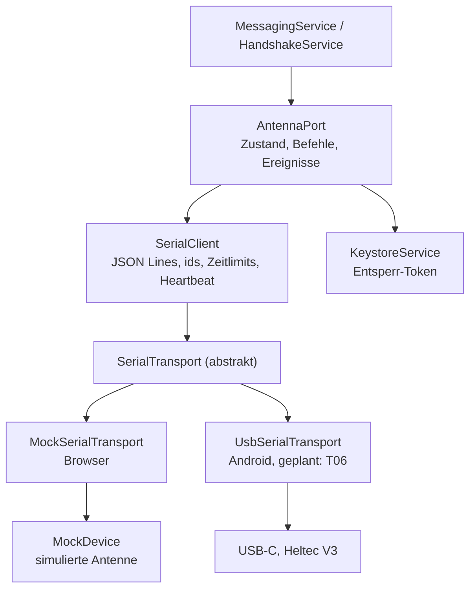
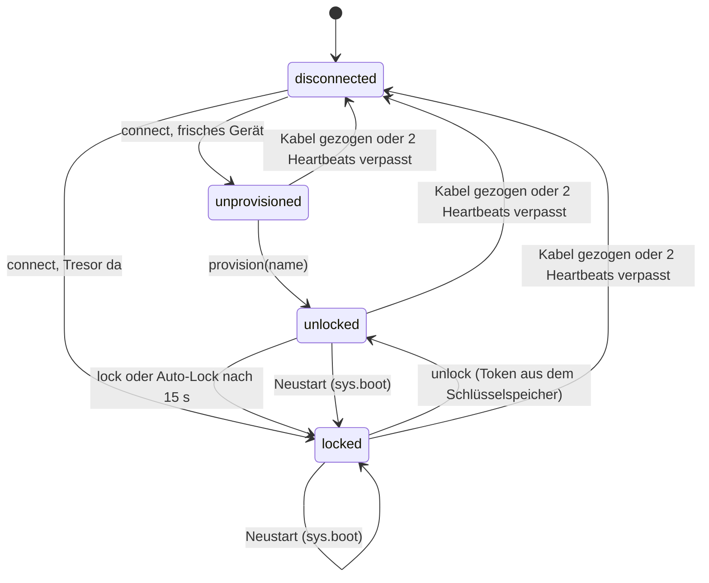

# Antenne

Stand: **nach T23**. Die App spricht die Antenne (Heltec V3) über die **Host-API „Offgrid Link v1“**: JSON Lines über USB-Serial. Die Antenne
besitzt Identität, Kontaktschlüssel, Verschlüsselung, Zähler und Kontaktliste; die App ist Oberfläche und Verlaufsspeicher. Die Befehle im Detail
stehen im [Serial-Protokoll](../protokoll/serial.md), die verbindlichen Spezifikationen unter `docs/esp-schnittstelle.md` verlinkt.

## Schichten



## Zustände

`AntennaPort.state` ist der Zustand der Antenne, so wie sie ihn in `sys.hello` und `sec.state` meldet, plus `disconnected`:



| Zustand | Bedeutung | Funk der Antenne |
|---|---|---|
| `disconnected` | keine Verbindung | – |
| `unprovisioned` | frische Antenne, keine Identität, kein Tresor | aus |
| `locked` | Tresor da, aber verschlüsselt | aus |
| `unlocked` | Tresor entschlüsselt, die Antenne arbeitet | an |

Beim Verbinden entsperrt der Port eine gesperrte Antenne **von selbst**. Nach einem Neustart oder Auto-Lock holt er ein neues `sys.hello` und
entsperrt wieder. Nach einem bewussten `lock()` entsperrt er nicht von selbst.

## Verbinden

1. `SerialClient.open()` und `SerialTransport.open()`: Der Transport öffnet die Leitung (115200 Baud, 8N1) und setzt **DTR und RTS sofort auf low**.
   Der Client verwirft alles bis zum ersten Zeilenende (die App kann mitten in einer Zeile einsteigen).
2. `sys.hello` wird **alle 500 ms wiederholt**, bis eine Antwort kommt (die Antenne verliert Befehle, während sie startet). Nach 10 Versuchen
   ohne Antwort: Fehler `no-hello`. Eine andere Hauptversion des Protokolls: `proto-mismatch`.
3. Zustand, Gerätedaten und die einmalige Sitzung aus `sys.hello` übernehmen; Heartbeat starten (alle 5 s `sys.ping`).
4. Ist die Antenne `locked`: entsperren.

## Entsperren

Das Entsperr-Geheimnis `K_phone` liegt im Android Keystore und verlässt es nie. Daraus entsteht pro Antenne ein Token, das die App **nie unverpackt**
über das Kabel schickt:

```text
unlock_token = HMAC-SHA256(K_phone, "og-unlock-v1" ‖ device_id_bytes)
shared       = X25519(app_eph_priv, device_eph_pub)
wrap_key     = HKDF-SHA256(shared, salt = nonce, info = "og-unlock-wrap-v1" ‖ device_id_bytes, L = 32)
wrapped      = iv (12) ‖ AES-256-GCM(wrap_key, iv, unlock_token, aad = device_id_bytes)     → 60 Bytes
```

Die Sitzung aus `sys.hello` ist **einmalig**: nach jedem Versuch mit `sec.provision` oder `sec.unlock`, auch nach einem Fehlschlag, holt die App ein
neues `sys.hello`. Falsches Token, falsche Antenne und kaputter Umschlag ergeben denselben Fehler (`unlock-failed`); nach drei Fehlversuchen in Folge
sperrt die Antenne zeitweise (`rate-limited`). Der Wrap stimmt mit dem Testvektor der Spezifikation überein
(`src/app/core/keystore/unlock-wrap.spec.ts`).

## Fehler

| Code | Wann |
|---|---|
| `no-device` | kein USB-Gerät gefunden (auch: USB-Plugin noch nicht eingebaut) |
| `permission-denied` | Android-Berechtigung für das USB-Gerät verweigert |
| `open-failed` | Leitung liess sich nicht öffnen |
| `no-hello` | die Antenne antwortet nicht auf `sys.hello` |
| `proto-mismatch` | andere Hauptversion des Protokolls |
| `lost` | Kabel gezogen oder zwei Heartbeats in Folge unbeantwortet |
| `unlock-failed` | Token abgelehnt |
| `rate-limited` | zu viele Fehlversuche |
| `keystore-failed` | der Schlüsselspeicher des Handys scheitert |

Befehle der Host-API werfen `DeviceError` mit dem Fehlercode der Antenne (`E_LOCKED`, `E_TOO_LONG`, …) oder lokal `E_TIMEOUT` und `E_DISCONNECTED`.

## Mock-Gerät im Browser

`MockDevice` spricht dieselbe Host-API wie die echte Antenne, mit denselben Antworten, Fehlercodes und Ereignissen. Es prüft das Entsperr-Token wirklich
(X25519, HKDF, AES-GCM), kennt Ratenbegrenzung und Auto-Lock und lässt Nachrichten nach 300 ms `sent`, 700 ms `relayed` und 1500 ms `delivered` werden.
Es funkt nicht: das Gegenüber ist erfunden. Im Browser startet es als schon eingerichtetes, gesperrtes Gerät mit den Demo-Kontakten und nimmt das erste
Token an. Die Entwickler-Hooks (`ogMock`) stehen unter [Erste Schritte](../erste-schritte.md).

## Offen

Das native USB-Serial-Plugin und das native Keystore-Plugin folgen mit T06; bis dahin steht auf Android ein Platzhalter, der nie ein Gerät findet.
