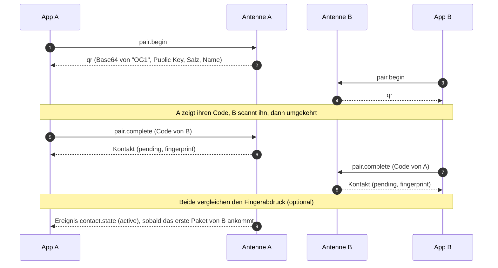

# Kontakte & Handshake

Stand: **nach T23**. Das Pairing macht die **Antenne**: Sie erzeugt die Schlüssel, leitet das gemeinsame Geheimnis ab und führt die Kontaktliste. Die App zeigt
den QR-Code, scannt den des Gegenübers und spiegelt die Kontakte (ohne Schlüssel).

## Ablauf

Zwei Personen treffen sich. **Beide** zeigen ihren QR-Code und scannen den des anderen.

- `HandshakeService.begin()` ruft `pair.begin` und liefert den **Text für den QR-Code**: Base64 von `"OG1" ‖ Public Key (32) ‖ Salz (16) ‖ Name`. Er läuft
  nach 300 s ab. Es gibt nur ein offenes Pairing; ein neues ersetzt das alte. Den eigenen Code nicht erneuern, nachdem er gescannt wurde und bevor man selbst gescannt
  hat: das Salz muss zum Code passen, den das Gegenüber hat.
- `HandshakeService.complete(qrText)` prüft nur, ob der Text nach einem OffGrid-Code aussieht (gültiges Base64, mindestens 51 Bytes, beginnt mit `OG1`), und ruft
  `pair.complete`. Der Rest ist Sache der Antenne. Ergebnis: der Kontakt mit `fingerprint`, Zustand `pending`.
- Der Kontakt wird `active`, sobald das erste gültige Paket des Gegenübers eintrifft (Ereignis `contact.state`).

| Fehler | Antenne | Bedeutung |
|---|---|---|
| `invalid-qr` | `E_INVALID_QR` | kein OffGrid-Code oder kaputt |
| `no-pairing` | `E_NO_PAIRING` | der eigene Code ist abgelaufen oder wurde nicht geholt |
| `self-pair` | `E_SELF_PAIR` | der eigene Code wurde gescannt |
| `contact-exists` | `E_CONTACT_EXISTS` | dieser Schlüssel ist schon Kontakt (mit `replace: true` ersetzen) |
| `storage-full` | `E_STORAGE_FULL` | alle 32 Plätze belegt |
| `antenna-not-ready` | – | die Antenne ist nicht entsperrt |
| `pairing-failed` | alles andere | |

## Fingerabdruck

Der Fingerabdruck ersetzt das frühere Vergleichsbild (Schlüssel-Muster). Er besteht aus **drei Vierergruppen** (z. B. „0501 3010 7790“) und ist auf beiden Handys
gleich, wenn der Austausch nicht verfälscht wurde. Die Antenne berechnet ihn: `SHA256("og1-fp" ‖ pub_low ‖ pub_high)` mit bytweise sortierten Schlüsseln, die
ersten 8 Bytes als Zahl modulo 10¹². Die App zeigt ihn nur an. Der Vergleich ist freiwillig; wer ihn auslässt, bleibt gegen einen gefälschten QR-Code ungeschützt.

## Kontakte spiegeln

| Methode | Antenne | Wann |
|---|---|---|
| `syncContacts()` | `contact.list` (Seiten zu 10) | bei jedem Entsperren |
| `refreshContact(id)` | `contact.get` | wenn eine Nachricht von einem unbekannten Platz kommt |
| `rename(id, name)` | `contact.rename` | Name 1–24 Bytes |
| `remove(id)` | `contact.delete` mit `confirm: true` | löscht Schlüssel und Zähler auf der Antenne und lokal den Verlauf |

Ein Kontakt hat auf der Antenne einen **Platz** (`contact_id`, 1 bis 32). Hat ein Platz inzwischen einen anderen öffentlichen Schlüssel (Antenne zurückgesetzt, Platz neu
vergeben), gehört der alte Verlauf nicht mehr dazu und wird mit dem alten Kontakt gelöscht. Kontaktschlüssel kennt die App nie: sie sind nie Teil eines Kontakt-Objekts.

!!! info "Geplant"

    Die Seiten „Kontakt hinzufügen“ und „Kontakt benennen“ folgen mit T11 (QR-Anzeige, Scanner). Die Zellwerte des Profilbilds (`og-avatar`) werden mit T02 festgelegt.
