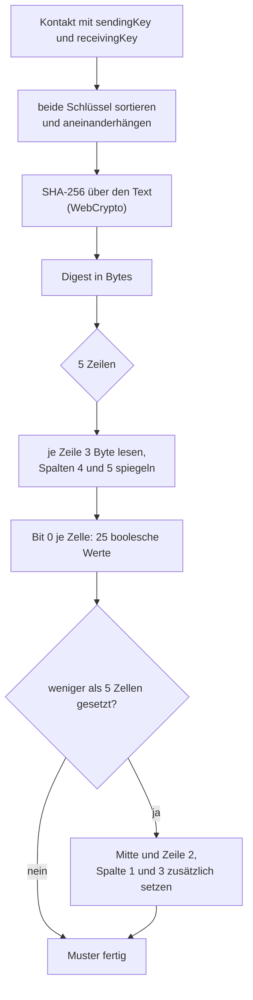

# Kontakte & Handshake

Kontakte kommen per **QR-Code-Handshake** hinzu: Beide Apps treffen sich einmal von Angesicht zu Angesicht und
tauschen ihre Schlüssel aus. Jede Nachricht ist mit einem **pro Kontakt ausgetauschten Schlüssel** verschlüsselt.

Stand: **nach T03** – Schlüsselerzeugung, Verschlüsselung und Schlüssel-Muster sind gebaut. Der Handshake-Ablauf
selber (QR-Ablauf, beide Rollen, Kontakt benennen) ist noch nicht gebaut.

## Schlüssel

Ein Schlüssel sind **16 Zufallsbytes**, dargestellt als **32 Zeichen Kleinbuchstaben-Hex**. Erzeugt wird er von
`CryptoService.newKey()`. Für jeden Kontakt gibt es zwei Schlüssel: einen zum Senden (`sendingKey`) und einen zum
Empfangen (`receivingKey`). Beide zusammen bestimmen das Muster.

Verschlüsselt wird mit **AES-GCM 128 Bit**, 12 Byte Initialisierungsvektor und 128 Bit Authentifizierungs-Tag. Als
`aad` (zusätzliche, nicht mitverschlüsselte Daten) laufen die Frame-Felder mit, die den Empfänger und die Richtung
bestimmen – dadurch kann ein umgeleiteter Frame nicht als gültig durchgehen. Jede Nachricht bekommt einen neuen
IV. Nur WebCrypto, keine Krypto-Pakete. Mehr dazu unter [Services](../architektur/services.md).

```ts
// src/app/core/crypto/crypto.service.ts
newKey(): string {
  return this.randomHex(SCHLUESSEL_BYTES);
}
```

## Schlüssel-Muster

Das Muster ist das **Profilbild** eines Kontakts: Wer sich gegenüber gegenüber sieht, vergleicht die beiden Muster
visuell, statt einen Schlüssel abzutippen.

- Ein **5 × 5 Raster** aus 25 Zellen.
- **Spiegelsymmetrisch**: Für jede der 5 Zeilen werden nur die ersten 3 Byte gelesen, die Spalten 4 und 5 sind die
  Spiegelung der Spalten 2 und 1.
- Grundlage ist **SHA-256** über die beiden Schlüssel des Kontakts, **sortiert** aneinandergehängt und als UTF-8
  kodiert. Das Bit 0 jedes gelesenen Bytes entscheidet, ob die Zelle gesetzt ist.
- Weil die Schlüssel sortiert werden, ergibt sich **für beide Rollen dasselbe Muster**: Wer sendet und wer empfängt,
  sieht dasselbe Bild.
- Ist das Bild fast leer (weniger als 5 gesetzte Zellen), setzt der Service zusätzlich die Mitte und die Zellen links
  und rechts in der zweiten Zeile.



Das eigene Muster – in den Einstellungen als Leerzustand – entsteht aus der Einstellung `install_id`, also aus
derselben Regel mit nur einem Text.

## Noch nicht gebaut

!!! info "Geplant"

    - **T08 – `HandshakeService`:** QR-Ablauf für beide Rollen, Austausch der Schlüssel, Anlegen des Kontakts,
      Zeichnen des QR-Codes mit dem eigenen Muster.
    - **T11 – Oberfläche:** Scanner (Kamera), Seite „Kontakt hinzufügen“ und Seite „Kontakt benennen“. Dort werden
      auch die Namen geprüft (höchstens 40 Zeichen und 60 Byte, siehe [Services](../architektur/services.md)) und die
      Meldung „Name zu lang“ angezeigt.

Die Signalstärke je Kontakt gehört zu [Nachrichten](nachrichten.md), das Protokoll für den Schlüsselaustausch zu
[Funk-Frames](../protokoll/funk-frames.md).