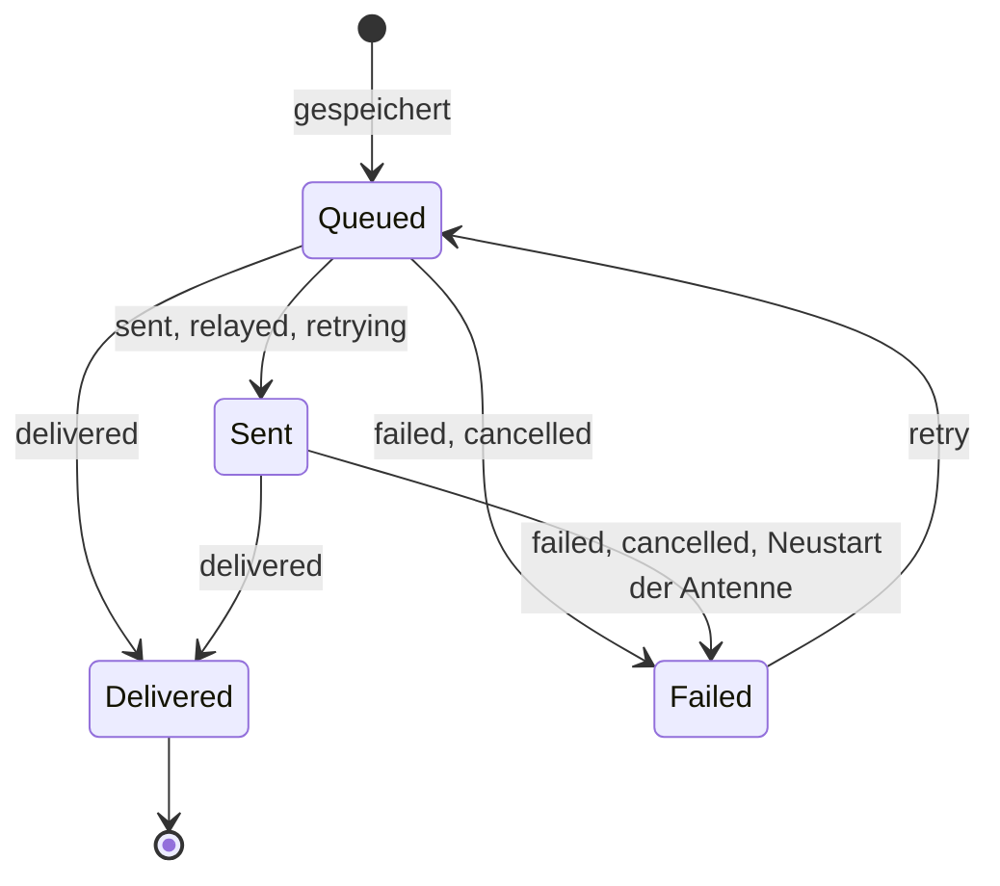

# Nachrichten

Stand: **nach T23**. Die App **verschlüsselt nichts** und baut keine Funkpakete: Sie schickt Klartext mit `msg.send` an die Antenne und bekommt
`msg.received` und `msg.status` zurück. Schlüssel, Zähler, Wiederholungen und Quittungen sind Sache der Antenne.

## Senden

`MessagingService.sendText(contactId, text)`:

1. Der Text wird getrimmt; leerer Text ergibt nichts.
2. Ist er länger als das gemeldete Limit (`limits.max_text_bytes`, 83 Bytes), wird er in Stücke geteilt (`splitText`), nie mitten in einem Zeichen. **Jedes
   Stück ist eine eigene Nachricht** im Verlauf.
3. Jedes Stück wird gespeichert (`Queued`, noch ohne `ctr` und `msg_ref`; `sent_at` setzt die App selbst) und mit `msg.send` (`type: "text"`) übergeben.
   Die Antwort liefert `ctr` (Zähler der Nachricht) und `msg_ref` (Handle für Statusereignisse); beide werden eingetragen.
4. Ist die Antenne nicht entsperrt oder ihre Warteschlange voll (`E_QUEUE_FULL`, 8 Plätze), bleibt die Nachricht `Queued` und geht hinaus, sobald die
   Antenne entsperrt ist bzw. ein Platz frei wird, in der Reihenfolge des Schreibens. Alle anderen Fehler machen die Nachricht zu `Failed`.

Alle Änderungen laufen nacheinander, damit ein Statusereignis nie vor der Antwort auf `msg.send` verarbeitet wird (sonst kennte die App das Handle noch nicht).

## Status

| Status der Antenne (`msg.status`) | Status in der App | Anzeige |
|---|---|---|
| `queued` | Queued | wartet |
| `sent`, `relayed`, `retrying` | Sent | gesendet |
| `delivered` | Delivered | zugestellt |
| `failed` (`timeout`, `locked`, `contact_deleted`, `radio_error`), `cancelled` | Failed | nicht gesendet |

Ein Status geht nie zurück. Einzige Ausnahme ist `retry`: Es legt eine gescheiterte Nachricht ohne `ctr` und `msg_ref` wieder in die Warteschlange.
Reaktionen und Standorte werden standardmässig **nicht quittiert**: sie enden bei „gesendet“.

Die Warteschlange der Antenne liegt nur im RAM. Bei `sys.boot` ist sie leer; alles, was noch `Queued` oder `Sent` war und ein Handle hatte, wird `Failed`.

## Empfangen

`msg.received` (`from` ist der Platz des Kontakts):

1. Kennt die App den Kontakt nicht, holt sie ihn mit `contact.get`.
2. Text und Standort: Gibt es schon eine eingehende Nachricht mit demselben `ctr`, wird sie verworfen. Sonst wird sie gespeichert (`Delivered`, `ctr`, `rssi`,
   `sent_at` = jetzt) und das Signal des Kontakts aktualisiert (`rssi`, `snr`). Ein Standort wird zusätzlich als Koordinate gespeichert.
3. Reaktionen werden nicht gespeichert, sondern als Ereignis weitergegeben (`MessagingService.reactions`).

Die Antenne liefert eine Wiederholung nie ein zweites Mal aus; der Zähler schützt trotzdem vor Doppelten.

## Reaktionen

`sendReaction(contactId, target, emoji)` sendet `type: "reaction"`. `target` ist `{ author, ref }`: `author` ist `me`, wenn die Ziel-Nachricht **ich**
geschrieben habe, sonst `peer`; `ref` ist `ctr & 0xFFFF` der Ziel-Nachricht. `emoji` ist eines aus der Tabelle (`src/app/core/messaging/reactions.ts`) oder
`null`, um die eigene Reaktion zurückzunehmen.

| Emoji | | | | | | |
|---|---|---|---|---|---|---|
| 👍 | ❤️ | 😂 | 😮 | 😢 | 🙏 | `null` entfernt |

Die Oberfläche für Reaktionen gibt es noch nicht.

## Signalstärke

Zu jedem Kontakt gehören die letzte Feldstärke in dBm (`lastRssi`) und das Signal-Rausch-Verhältnis (`lastSnr`) des letzten gültigen Pakets; beide liefert die
Antenne. Weil sie keine Uhr hat, stempelt die App den Zeitpunkt beim Empfang selbst. Daraus berechnet `src/app/core/messaging/signal.ts` den Level für
die Signal-Balken (`og-signal-bars`).

`signalLevel(rssi, seenAt, now)`:

| Bedingung | Level |
|---|---|
| kein `rssi` oder kein `seenAt` | 0 |
| Signal älter als 15 Minuten | 0 |
| `rssi ≥ -80` dBm | 4 |
| `rssi ≥ -95` dBm | 3 |
| `rssi ≥ -105` dBm | 2 |
| `rssi ≥ -115` dBm | 1 |
| alles andere | 0 |

`signalLabel(level)` liefert den Text zum Level (das `aria-label` der Balken):

| Level | Text |
|---|---|
| 4 | Signal sehr gut |
| 3 | Signal gut |
| 2 | Signal mittel |
| 1 | Signal schwach |
| 0 | Ausser Reichweite |

## Zeit- und Funkformate

Alle Zeitfunktionen liegen in `src/app/core/format/time.ts` und benutzen
`Intl.DateTimeFormat('de-CH', { timeZone: 'Europe/Zurich' })`. Die Seite übergibt `new Date()` als `now`.

| Funktion | Ergebnis |
|---|---|
| `formatTime(iso)` | Uhrzeit `HH:mm` im 24-Stunden-Format. |
| `formatListTime(iso, now)` | heute `HH:mm`; gestern „Gestern“; innerhalb von 7 Tagen der kurze Wochentag („Mo.“); sonst `dd.MM.yy`. |
| `formatLastSeen(iso, now)` | heute „zuletzt `HH:mm`“; gestern „zuletzt gestern“; sonst „zuletzt `dd.MM.`“; `null` → „noch nie empfangen“. |
| `formatDay(iso, now)` | heute „HEUTE“, gestern „GESTERN“, sonst `dd.MM.yyyy`. |
| `formatMHz(freqHz)` (`src/app/core/format/radio.ts`) | Frequenz in MHz, z. B. `868100000` → „868“. |

„Heute“ und „Gestern“ richten sich nach dem Kalendertag in Zürich, nicht nach UTC. Die Zeitumstellung ändert die Zuordnung des Tages deshalb nicht.

## Länge der Texte

`src/app/core/messaging/limits.ts` rechnet in UTF-8-Bytes, weil eine Funk-Nachricht eine feste Grösse hat:

| Funktion | Bedeutung |
|---|---|
| `contentBytes(text)` | UTF-8-Bytelänge des Textes: `new TextEncoder().encode(text).length`. JSON-Escapes werden nicht mitgezählt. |
| `maxContentBytes(max)` | Das gemeldete Textlimit, **unverändert** (`sys.hello` → `limits.max_text_bytes`, 83). Kein Abzug, keine feste Obergrenze. Verschlüsselung und Paketaufbau macht die Antenne. |
| `isValidDisplayName(name)` | Anzeigename: getrimmt mindestens 1 und höchstens 24 UTF-8-Bytes. |
| `splitText(text, maxBytes)` | Teilt in Stücke von höchstens `maxBytes` Bytes, nie mitten in einem Zeichen (Emoji bleiben ganz). |

!!! note

    Die Grenzwerte stammen aus „Offgrid Host Interface v1“ (§7.3 Namen, §7.5 Text, §12 Limits). Hat eine Antenne ein anderes Limit, übernimmt die App
    es aus `sys.hello`; die 83 sind nur der Standardwert.
