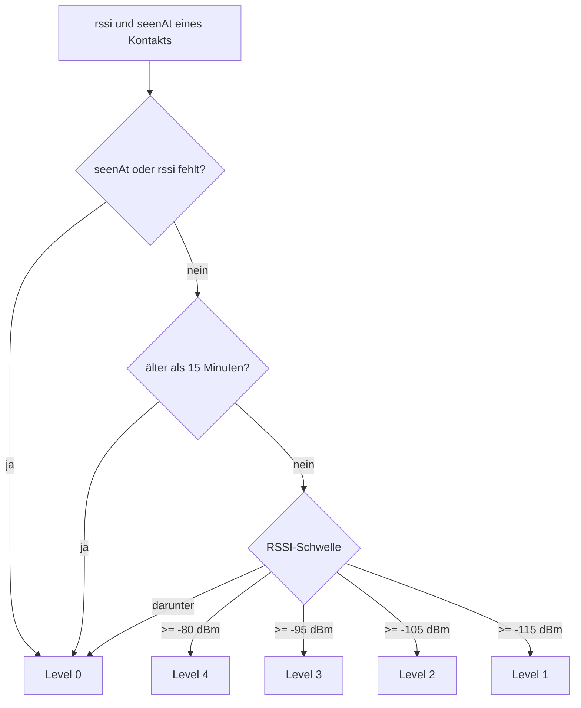

# Nachrichten

Nachrichten gehen als Funk-Frames über die Antenne raus und kommen von dort wieder herein. Jede Nachricht ist mit dem
pro Kontakt ausgetauschten Schlüssel verschlüsselt.

Stand: **nach T03** – Zeitformate, Textlängen und die Signalstärke je Kontakt sind gebaut. Senden, Empfangen,
Warteschlange und Zustellstatus sind noch nicht gebaut.

## Zeitformate

Alle Zeit- und Datumsangaben der App laufen über `src/app/core/format/time.ts`. Formatiert wird mit
`Intl.DateTimeFormat('de-CH', …)` in der Zeitzone `Europe/Zurich`. Die Seiten übergeben `new Date()` als `now`;
„heute“, „gestern“ und „innerhalb von 7 Tagen“ werden über den Kalendertag **in dieser Zeitzone** entschieden.

| Anzeige | Funktion | Beispiele |
|---|---|---|
| Uhrzeit | `formatTime(iso)` | `14:32` |
| Listenzeit in der Kontaktliste | `formatListTime(iso, now)` | heute `14:32`, gestern „Gestern“, unter 7 Tagen „Mo.“, sonst `21.10.26` |
| Letzter Empfang | `formatLastSeen(iso, now)` | „zuletzt 14:32“, „zuletzt gestern“, „zuletzt 21.10.“, bei `null` „noch nie empfangen“ |
| Tagestrenner im Chat | `formatDay(iso, now)` | „HEUTE“, „GESTERN“, sonst `21.10.2026` |

Weitere Formattexte stehen in `src/app/core/format/radio.ts`: `formatMHz(freqHz)` liefert die Frequenz in MHz ohne
Nachkommastellen (`868100000` → „868“). Vollständige Signaturen: [Services](../architektur/services.md).

## Signalstärke je Kontakt

Die Kontaktliste zeigt pro Kontakt eine kleine Anzeige mit 0 bis 4 Balken. Der Wert kommt aus
`src/app/core/messaging/signal.ts` und ist **zeitabhängig**: Ein alter Empfangswert zählt nicht mehr.

| RSSI in dBm | Level | Text für das `aria-label` |
|---|---|---|
| ab −80 | 4 | Signal sehr gut |
| ab −95 | 3 | Signal gut |
| ab −105 | 2 | Signal mittel |
| ab −115 | 1 | Signal schwach |
| darunter, kein RSSI, nie gesehen oder älter als 15 Minuten | 0 | Ausser Reichweite |

Diese Texte sind auch für Screenreader da, weil die Balken selbst nur Grafik sind. Welche Komponente sie anzeigt und
wo sie im Screen steht, steht im Design-System und auf der Seite [Screens](../oberflaeche/screens.md) – beides ist noch
geplant (ab **T01**/**T02** für die Komponente, ab **T10** für die Liste).

## Länge der Texte

Ein zu langer Text passt nicht in einen Frame. `src/app/core/messaging/limits.ts` rechnet aus, wie viele Byte ein Text
im Klartext-JSON braucht, und begrenzt die Länge:

- `contentBytes(text)` – Platz des Textes im JSON, die zwei Anführungszeichen zählen nicht mit.
- `maxContentBytes(max)` – grösster Text, der noch passt: 33 Byte Frame-Overhead plus 36 Byte JSON-Hülle, gedeckelt
  bei 180 Byte.
- `isValidDisplayName(name)` – ein Anzeigename muss höchstens 40 Zeichen **und** höchstens 60 Byte haben, damit der
  `hs`-Frame immer passen kann.

Diese Grenzen sind beim Senden später die Grundlage für den Fehler „Nachricht zu lang“ auf der Chat-Seite (ab **T12**).

## Noch nicht gebaut

!!! info "Geplant"

    - **T07 – `MessagingService`:** Senden über die Antenne, Empfang und Entschlüsseln, Warteschlange bei getrennter
      Antenne, Zustellstatus je Nachricht.
    - **T17 – Standort-Nachrichten:** Standort als eigene Nachrichtenart.
    - **T15/T16** – Android-Build und Empfang im Hintergrund.

Der Aufbau eines Funk-Frames steht in [Funk-Frames](../protokoll/funk-frames.md), die Verbindung zur Antenne in
[Antenne](antenne.md).