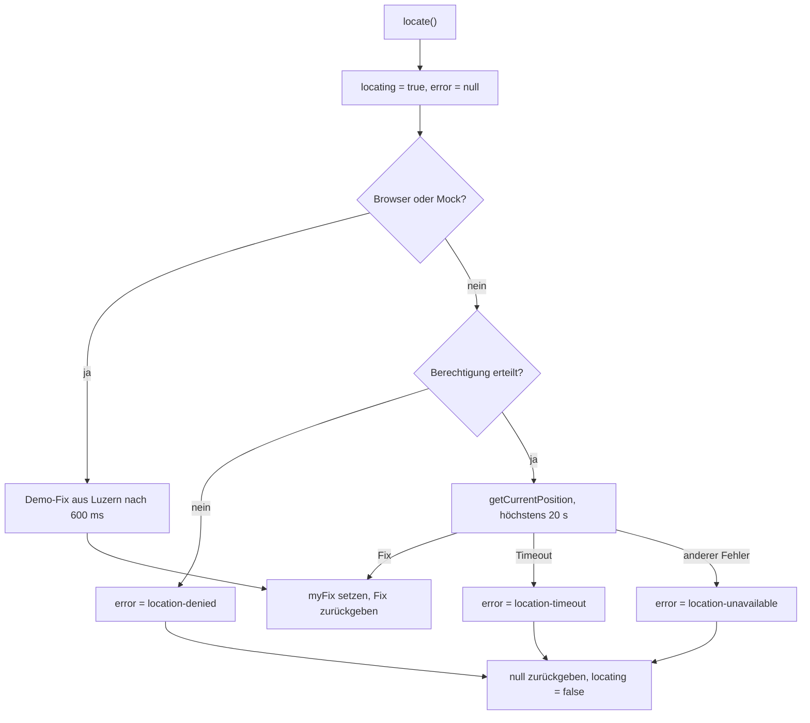

# Standort

Stand: **nach T17** (Kern mit GPS und Geo-Funktionen) und **T23** (Senden und Empfangen über die Host-API).

Die App hat **keine Karte**: ohne Internet gibt es keine Kartenkacheln. Stattdessen rechnet sie aus den Koordinaten
**Entfernung** und **Himmelsrichtung** und übergibt die Koordinaten an eine Offline-Karten-App auf dem Handy.
Der Standort-Kern (T17) ist gebaut: `LocationService` bestimmt den eigenen Standort, `geo.ts` rechnet die Geo-Werte.
Die Oberfläche dazu (T18) und der Live-Standort (T19) fehlen noch.

## Der eigene Standort

`LocationService` (`src/app/core/location/location.service.ts`) ist ein Singleton (`providedIn: 'root'`).

| Name | Typ | Beschreibung |
|---|---|---|
| `myFix` | `Signal<GeoFix \| null>` | Der eigene Standort, falls schon bestimmt. |
| `locating` | `Signal<boolean>` | `true`, solange `locate()` läuft. |
| `error` | `Signal<LocationErrorCode \| null>` | Der Fehler der letzten Ortung. |
| `locate()` | `Promise<GeoFix \| null>` | Bestimmt den eigenen Standort; liefert `null` bei einem Fehler. |
| `isFresh(fix, now)` | `boolean` | `true`, wenn der Fix höchstens 10 Minuten alt ist. |

Ein `GeoFix` (`src/app/core/models/message.ts`) ist `{ latitude, longitude, accuracy, at }`. `accuracy` ist die Genauigkeit
in Metern, `at` der Zeitpunkt der Messung als ISO-Text (UTC).

### Ablauf von `locate()`

1. `locating` wird `true`, `error` wird `null`.
2. **Browser oder Mock:** Es gibt keinen echten GPS. Die App liefert nach **600 ms** den Demo-Fix
   `{ latitude: 47.05021, longitude: 8.30934, accuracy: 8 }` (Luzern) und ruft die Geolocation-API nicht auf.
   Das macht die Vorführung reproduzierbar.
3. **Nativ:** `Geolocation.checkPermissions()`. Erlaubt ist `location === 'granted'` **oder**
   `coarseLocation === 'granted'`. Sonst fragt die App die Berechtigung mit
   `requestPermissions({ permissions: ['location', 'coarseLocation'] })` an und prüft erneut.
4. Der GPS wird mit `getCurrentPosition({ enableHighAccuracy: true, timeout: 20000, maximumAge: 30000 })` gefragt.
   Ein eigener 20-Sekunden-Timer läuft daneben; der schnellere gewinnt.
5. Ergebnis: `myFix` wird gesetzt und der Fix zurückgegeben. Die Genauigkeit wird auf ganze Meter gerundet,
   `at` ist `new Date(position.timestamp).toISOString()`.
6. `locating` ist am Ende immer `false`.

### Fehlercodes

`LocationErrorCode` (`src/app/core/models/errors.ts`) hat vier Werte:

| Code | Bedeutung |
|---|---|
| `location-denied` | Die Berechtigung wurde nicht erteilt. |
| `location-timeout` | Der GPS hat nach 20 Sekunden nicht geantwortet. |
| `location-unavailable` | Der GPS hat einen anderen Fehler gemeldet. |
| `no-maps-app` | Wird erst mit der Karten-App (T18) benutzt. |

### Android

Das Manifest (`android/app/src/main/AndroidManifest.xml`) hat mit T17 die Berechtigungen
`ACCESS_COARSE_LOCATION` und `ACCESS_FINE_LOCATION` und deklariert den GPS als optionales Feature
(`android.hardware.location.gps` mit `required="false"`): ohne GPS läuft die App, nur der eigene Standort fehlt.
Das Plugin `@capacitor/geolocation` ist eingebunden. GPS funktioniert **ohne** Mobilnetz; die App fordert keinen
Hintergrund-Standort an.

## Geo-Funktionen

`src/app/core/location/geo.ts` enthält reine Funktionen ohne Seiteneffekte (Haversine-Formel, Erdradius 6 371 000 m).

| Funktion | Ergebnis |
|---|---|
| `distanceMeters(a, b)` | Entfernung zwischen zwei Punkten in Metern (Haversine). |
| `bearingDegrees(from, to)` | Anfangskurs in Grad: 0 bis 359.9, 0 = Norden, im Uhrzeigersinn. |
| `compassName(deg)` | Himmelsrichtung aus acht Sektoren à 45°: „Norden“, „Nordosten“, „Osten“, „Südosten“, „Süden“, „Südwesten“, „Westen“, „Nordwesten“. Die Mitte des Sektors liegt bei 0°, 45°, 90° … |
| `formatDistance(m)` | Erst auf 10 m runden, dann die Einheit wählen: unter 1000 m „850 m“; sonst auf 0.1 km gerundet „1.2 km“; ab 10 km ganze Kilometer „12 km“. Zahlen im Format `de-CH`. |
| `formatCoordinate(lat, lon)` | Koordinate mit fünf Nachkommastellen und Hemisphäre: „47.05021° N, 8.30934° O“ (S bei negativer Breite, W bei negativer Länge). |
| `formatCoordinatePlain(lat, lon)` | Dieselbe Koordinate zum Kopieren, ohne Hemisphäre: „47.05021, 8.30934“. |
| `formatAccuracy(m)` | Genauigkeit „±8 m“ (gerundet, mindestens 1 m). |
| `formatAgo(iso, now)` | Alter des Fixes: unter einer Minute „gerade eben“, unter einer Stunde „vor 12 Min.“, unter einem Tag „vor 3 Std.“, sonst das Listenformat aus `formatListTime`. |
| `roundCoord(v)` | Koordinate auf sechs Nachkommastellen runden (für den Funk). |

Bis mit T18 hat die App keine Oberfläche, die diese Funktionen benutzt.

## Senden und Empfangen

Ein Standort ist eine Nachricht vom Typ `geo` der Host-API (`msg.send` mit `lat`, `lon`, `age_s`). Die App baut kein Funkpaket; die Antenne kodiert die Koordinaten und
meldet einen eingehenden Standort als `msg.received`. Die App speichert ihn als Standort-Nachricht samt Koordinate; weil die Antenne keine Uhr hat, setzt die App den Zeitpunkt der
Messung als „jetzt minus `age_s`“. Quittungen sind für Standorte standardmässig aus, die Nachricht endet bei „gesendet“. Details in [Nachrichten](nachrichten.md).

`MessagingService.sendLocation(contactId, fix)` nimmt den `GeoFix` aus dem `LocationService` direkt entgegen:

1. Die Nachricht wird gespeichert (`kind 'location'`, leerer Inhalt, Status `Queued`).
2. Die Koordinate wird gespeichert (`context 'einmal'`, `recordedAt` = `fix.at`).
3. Gesendet wird mit `msg.send` und `type: "geo"`; Warteschlange, Status und Wiederholung laufen wie bei einem Text.

## Grenzen

- Der Richtungspfeil zeigt die Richtung **relativ zu Norden**, nicht zur Handyausrichtung: die App hat keinen Kompass-Sensor.
- Die Genauigkeit hängt vom GPS ab; über 100 m Ungenauigkeit soll die App einen Hinweis zeigen (mit T18).
- Die Entfernung wird nur angezeigt, wenn der eigene Standort höchstens 10 Minuten alt ist (`isFresh`).

!!! info "Geplant"

    Die Oberfläche für den Standort (Senden und Anzeigen) folgt mit T18. Der Live-Standort (T19) ist offen: das `geo`-Paket kennt keine
    Freigabe-Kennung, das ist mit dem Firmware-Team zu klären.
