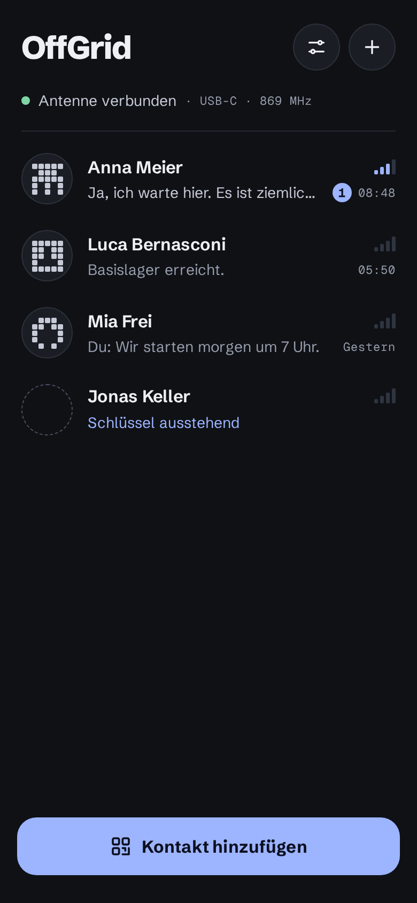
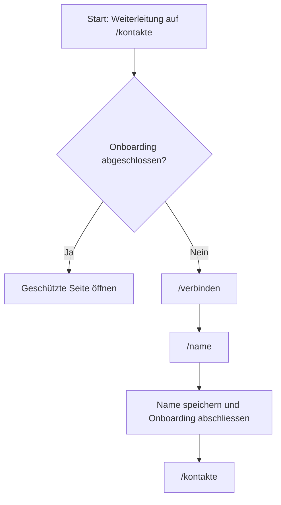

# Screens

Diese Seite beschreibt die gebauten Screens der App. Weitere Screens folgen mit T11 bis T13.

!!! info "Geplant"

    Die Screens „Kontakt hinzufügen“, „Kontakt benennen“, „Chat“ und „Einstellungen“ werden mit
    T11 bis T13 dokumentiert.

    Der Standort-Kern (T17) hat noch keine Oberfläche: er liegt nur im Kern (`src/app/core/location/`). Die
    Standort-Screens folgen mit T18, der Live-Standort mit T19.

## Verbinden (`/verbinden`)

Der Screen ist Onboarding-Schritt 1 und dient zugleich für eine neue Verbindung aus den Einstellungen. Beim Öffnen
startet die Seite `AntennaPort.connect()`, sofern die Antenne getrennt ist.

{ width="260" }

### Aufbau

1. Ein dekorativer Hero zeigt drei konzentrische Ringe, eine quadratische Kachel und das Antennen-Icon.
2. Im Onboarding steht über dem Titel „SCHRITT 1 VON 2“. Nach abgeschlossenem Onboarding entfällt dieser Hinweis.
3. Der Titel lautet „Antenne anschliessen“. Darunter erklärt der Text, dass die OffGrid-Antenne per USB-C mit dem
   Handy verbunden wird.
4. Eine kompakte Schrittliste zeigt den Verbindungsfortschritt.
5. Ein Fehler erscheint als Hinweis unter der Schrittliste, wenn die Antenne einen Fehlercode meldet.
6. Der fixe Fussbereich enthält „Weiter“ und „Erneut suchen“.

### Schrittliste

Die Schrittliste reagiert live auf `AntennaPort.state`, `AntennaPort.device` und `AntennaPort.connecting`. Für jeden Schritt
hat der Zustand „erledigt“ Vorrang vor „aktiv“.

| Schritt | Erledigt | Aktiv | Offen |
|---|---|---|---|
| USB-Gerät erkannt | Die Gerätedaten sind vorhanden. Als Meta steht der Gerätename. | Eine Verbindung wird gesucht oder aufgebaut. | Es sind keine Gerätedaten vorhanden. |
| Verbindung wird aufgebaut | Die Antenne ist verbunden und hat den Zustand `unprovisioned`, `locked` oder `unlocked`. | Eine Verbindung wird gesucht oder aufgebaut. | Die Antenne ist getrennt. |
| Funkmodul bereit | Die Antenne ist im Zustand `unlocked`. Als Meta steht „FW <Firmware-Version>“. | – | Die Antenne ist noch nicht entsperrt. |

### Weiter-Button

„Weiter“ ist in folgenden Fällen aktiv:

- Die Antenne ist entsperrt (`unlocked`). Ohne offenes Onboarding führt der Button zu `/name`, sonst zu
  `/einstellungen`.
- Die Antenne ist frisch (`unprovisioned`) und das Onboarding ist noch nicht abgeschlossen. Der Button führt zu
  `/name`; dort wird das Gerät eingerichtet.

„Erneut suchen“ wiederholt die Suche nach der Antenne. Im Zustand `locked` – also nach einem fehlgeschlagenen
Entsperren – löst die Schaltfläche `AntennaPort.unlock()` aus: Das Gerät ist noch verbunden, ein erneutes
`AntennaPort.connect()` kehrt deshalb sofort zurück und würde nichts bewirken. In allen anderen Zuständen startet die
Schaltfläche `AntennaPort.connect()`. Während `connecting` ist der Button deaktiviert.

### Antennenzustände und Fehler

| Zustand | Bedeutung für den Screen |
|---|---|
| `disconnected` | Die Antenne ist nicht verbunden. Beim Öffnen wird die Verbindung gestartet. |
| `unprovisioned` | Das Gerät ist verbunden, besitzt aber noch keinen Tresor. Im Onboarding darf es mit „Weiter“ zur Namensseite. |
| `locked` | Das Gerät ist verbunden, sein Tresor ist aber geschlossen. |
| `unlocked` | Das Gerät ist vollständig bereit. „Weiter“ ist aktiv. |

Die folgenden Fehlertexte zeigt der Screen als Hinweis:

| Fehlercode | Text |
|---|---|
| `no-device` | Keine Antenne gefunden. Prüfe das USB-C-Kabel. |
| `permission-denied` | Zugriff auf die Antenne wurde nicht erlaubt. |
| `open-failed` | Die Antenne liess sich nicht öffnen. Steck sie neu ein. |
| `no-hello` | Die Antenne antwortet nicht. |
| `proto-mismatch` | Die Firmware der Antenne passt nicht zu dieser App-Version. |
| `lost` | Verbindung zur Antenne verloren. |
| `unlock-failed` | Die Antenne lässt sich mit diesem Handy nicht entsperren. |
| `rate-limited` | Zu viele Versuche. Warte kurz und versuch es erneut. |
| `keystore-failed` | Der Schlüsselspeicher des Handys ist nicht verfügbar. |

## Name (`/name`)

Der Screen ist Onboarding-Schritt 2. Er fragt den Anzeigamen ab, der beim Hinzufügen an Kontakte übertragen wird.

### Aufbau

1. Über dem Titel steht „SCHRITT 2 VON 2“.
2. Der Titel lautet „Wie heisst du?“.
3. Der Erklärungstext lautet „Dieser Name wird beim Hinzufügen an deine Kontakte übertragen“.
4. Eine Karte enthält das Eingabefeld „Anzeigename“.
5. Der fixe Fussbereich enthält den Button „Los gehts“.

### Eingabe

Der Name wird getrimmt und nach UTF-8-Bytes geprüft, nicht nach Zeichen. Gültig sind 1 bis 24 Bytes. Umlaute zählen
je zwei Bytes. Das Eingabefeld setzt deshalb kein `maxlength`; ein ungültiger Wert wird beim Verlassen des Feldes
gemeldet:

> Der Name muss 1 bis 24 Bytes lang sein (Umlaute zählen doppelt).

„Los gehts“ ist nur aktiv, wenn der Name gültig ist und nicht bereits gespeichert wird.

### Speichern

Beim Speichern unterscheidet der Screen den Zustand der Antenne:

- Bei einem frischen Gerät (`unprovisioned`) wird `AntennaPort.provision(name)` aufgerufen. Nach erfolgreicher
  Einrichtung ist das Gerät entsperrt (`unlocked`).
- Bei einem eingerichteten und entsperrten Gerät (`unlocked`) wird der Name mit `id.set_name` an das Gerät gegeben.
- In allen anderen Zuständen wird kein Name gespeichert und ein Seitenfehler angezeigt.

Danach speichert die App den Anzeigamen, schliesst das Onboarding ab und wechselt mit `replaceUrl` zu `/kontakte`.

Mögliche Seitenfehler:

| Fehlercode | Text |
|---|---|
| `unlock-failed` | Die Antenne lässt sich mit diesem Handy nicht entsperren. |
| `rate-limited` | Zu viele Versuche. Warte kurz und versuch es erneut. |
| `keystore-failed` | Der Schlüsselspeicher des Handys ist nicht verfügbar. |
| `lost` | Verbindung zur Antenne verloren. |
| `antenna-not-ready` | Antenne nicht bereit. Verbinde sie zuerst. |

## Kontakte (`/kontakte`)

Der Screen ist die Hauptseite der App: Er listet die Kontakte mit letzter Nachricht, Signalstärke und den
ungelesenen Nachrichten. Jede Zeile führt in den Chat, der fixe Fussbereich zum Hinzufügen eines Kontakts.

{ width="260" }

### Aufbau

1. Die Kopfzeile zeigt links den Titel „OffGrid“. Rechts stehen zwei runde Icon-Buttons: „Einstellungen“ führt zu
   `/einstellungen`, „Kontakt hinzufügen“ führt zu `/kontakte/neu`. Im Leerzustand bleibt nur „Einstellungen“.
2. Darunter folgt die Antennen-Statuszeile. Sie ist ein Link auf `/verbinden`.
3. Eine Trennlinie trennt die Statuszeile von der Liste.
4. Die Kontaktliste (`<nav>` mit der Beschriftung „Kontakte“) zeigt je Kontakt eine Zeile. Die ausstehenden
   Kontakte stehen hinter den Kontakten.
5. Der fixe Fussbereich enthält den Button „Kontakt hinzufügen“ (im Leerzustand „Ersten Kontakt hinzufügen“).

### Kontaktzeile

| Teil | Inhalt |
|---|---|
| Avatar | `og-avatar` in der Grösse 48. Das Muster entsteht aus dem Public Key des Kontakts. |
| Name | Der Anzeigename des Kontakts. |
| Signalbalken | `og-signal-bars` in der Grösse `md`: so viele aktive Balken wie das Level des Kontakts. |
| Vorschau | Die letzte Nachricht in einer Zeile (mit Ellipsis). |
| Badge | `og-badge` mit der Anzahl der ungelesenen Nachrichten; ab 100 zeigt der Badge „99+“. Ohne ungelesene Nachrichten gibt es kein Badge. |
| Zeit | Die Zeit der letzten Nachricht. Ohne Nachricht bleibt die Stelle leer. |

Die Vorschau richtet sich nach der letzten Nachricht:

| Nachricht | Vorschau |
|---|---|
| Eingehende Textnachricht | Der Text der Nachricht. |
| Ausgehende Textnachricht | „Du: “ und der Text der Nachricht. |
| Eingehende Standortnachricht | „Standort“ |
| Ausgehende Standortnachricht | „Du: Standort“ |
| Keine Nachricht | „Noch keine Nachrichten“ |

Eine ungelesene Nachricht färbt die Vorschau kräftiger (`--og-text-2`) als eine gelesene (`--og-text-3`).

Die Zeit steht als `formatListTime`: heute „HH:mm“, gestern „Gestern“, innert sieben Tagen der kurze Wochentag,
sonst das Datum. Der Signalbalken spricht den Text des Levels an („Signal sehr gut“ bis „Ausser Reichweite“).

Die ganze Zeile ist ein Link auf `/chat/<Platz des Kontakts>`.

### Reihenfolge

Die Kontakte stehen nach ihrer letzten Nachricht, die neueste zuerst. Kontakte ohne Nachricht stehen hinter den
Kontakten mit Nachricht, sortiert nach ihrer Platznummer. Eine neue Nachricht schiebt den Kontakt nach oben.

### Signalstärke

Das Level eines Kontakts kommt aus der Feldstärke (`lastRssi`) und dem Alter der letzten eingehenden Nachricht.
Die Antenne liefert keinen Zeitpunkt des Empfangs, deshalb stempelt die App die letzte eingehende Nachricht selbst.
Eine Feldstärke, die älter als 15 Minuten ist, zählt nicht mehr: Das Level ist dann 0 („Ausser Reichweite“).
Die Schwellen und die Texte der Level stehen in [Nachrichten](../funktionen/nachrichten.md).

### Ausstehende Zeilen

Ein Kontakt, dessen Schlüssel noch aussteht (`state` `pending`), steht als eigene Zeile hinter den Kontakten:

- Die Zeile ist kein Link, sondern ein `<div>`: Es gibt noch keinen Chat zu diesem Kontakt.
- Der Avatar hat den Zustand `pending` (gestrichelter Kreis ohne Muster).
- Die Signalbalken zeigen Level 0 und werden nicht angesagt (`aria-hidden`).
- Statt Vorschau und Zeit steht der Text „Schlüssel ausstehend“.

### Antennen-Statuszeile

Die Statuszeile ist ein Link auf `/verbinden` und zeigt, ob die Antenne bereit ist:

| Zustand | Statuspunkt | Text | Meta |
|---|---|---|---|
| Antenne entsperrt (`unlocked`) | grün (`ok`) | „Antenne verbunden“ | „· USB-C · 869 MHz“ |
| Alle anderen Zustände | rot (`danger`) | „Antenne getrennt“ | „· Tippen zum Verbinden“ |

Die Frequenz liest die App beim Gerät ab (`radio.get`, Feld `freq_mhz`). Gültig sind 150 bis 960 MHz; angezeigt
wird der Wert in MHz, abgerundet. Antwortet das Gerät nicht oder nennt es keine gültige Frequenz, bleibt der
Meta-Text bei „· USB-C“.

### Leerzustand

Ohne Kontakte und ohne ausstehende Kontakte ersetzt ein zentrierter Block die Liste:

- Eine Illustration (`aria-hidden`): das eigene Muster (aus der Install-Id) · drei Punkte · ein Avatar im Zustand
  `pending`.
- Der Titel „Noch keine Kontakte“.
- Der Text „Triff dich mit jemandem, der OffGrid nutzt, und scannt gegenseitig eure Codes. Danach könnt ihr ohne
  Mobilnetz schreiben.“
- Der Button im Fussbereich lautet „Ersten Kontakt hinzufügen“.

### Daten

Die Seite liest ihre Daten aus dem `MessagingService`: `contacts` liefert je Kontakt die letzte Nachricht, die
Anzahl der ungelesenen Nachrichten und das Signal-Level, `unreadCount(contactId)` die Ungelesenen. Der Zustand
der Antenne kommt aus dem `AntennaPort`, das eigene Muster aus der Install-Id der `SettingsService`. Die Signale
sind in [Services](../architektur/services.md) beschrieben.

### Im Browser prüfen

Im Browser (Mock-Antenne, Demo-Daten) lässt sich der Screen ohne Hardware prüfen:

- Eine neue eingehende Nachricht schiebt den Kontakt nach oben:
  `window.ogMock.receive('Luca Bernasconi', 'Test')`.
- `window.ogMock.drop()` trennt die Antenne: Die Statuszeile zeigt „Antenne getrennt“.
- Für den Leerzustand startet die App ohne Demo-Daten; das steht unter „Onboarding im Browser testen“.

## Onboarding-Guard

Der funktionale Guard `onboardingGuard` schützt alle Routen ausser den beiden Onboarding-Schritten. Ist das Onboarding
nicht abgeschlossen, liefert er eine URL auf `/verbinden`. Ist es abgeschlossen, gibt er die Route frei.



Geschützt sind:

- `/kontakte` und `/kontakte/neu`
- `/kontakte/neu/fertig/:contactId`
- `/chat/:contactId` und `/chat/:contactId/standort/:messageId`
- `/gruppe/neu` und `/gruppe/:groupId`
- `/einstellungen`, `/einstellungen/export` und `/einstellungen/import`

`/verbinden` und `/name` bleiben ohne Guard erreichbar. Läuft der App-Start noch, wartet der Guard auf
`AppStartService.init()`. Dadurch wird der Onboarding-Status nicht geprüft, bevor die Einstellungen geladen sind.

## Onboarding im Browser testen

Für einen leeren Browser-Start ohne Demo-Daten setzt die Entwicklerkonsole vor dem Neuladen:

```javascript
localStorage.setItem('og.noseed', '1');
```

Danach startet die App ohne Demo-Kontakte. Die simulierte Antenne beginnt als frisches, noch nicht eingerichtetes
Gerät. Ohne diesen Eintrag startet sie mit Demo-Daten und abgeschlossenem Onboarding.

Die automatisierten Prüfungen für Guard und beide Screens stehen in der [Testübersicht](../qualitaet/tests.md).
