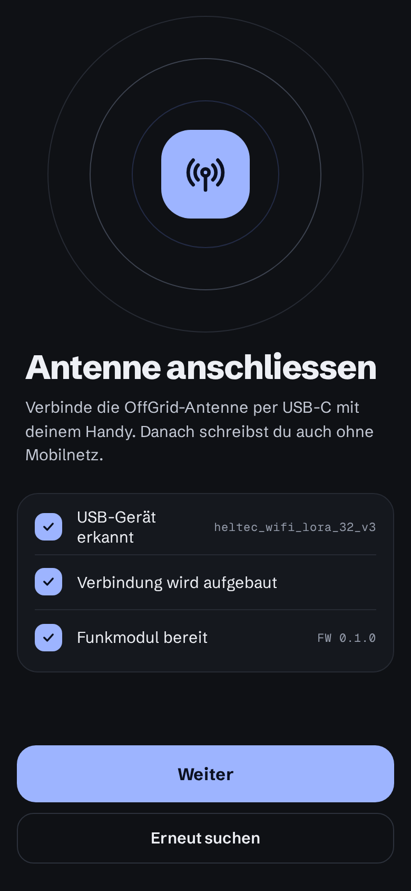
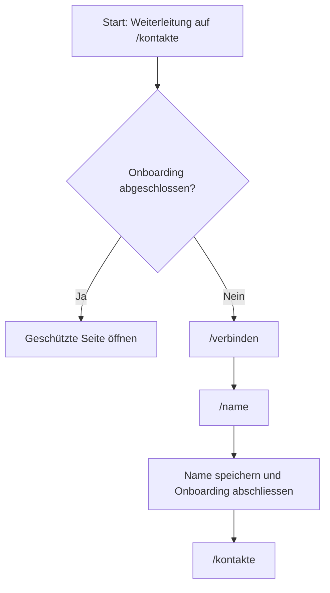

# Screens

Diese Seite beschreibt die gebauten Screens der App. Weitere Screens folgen mit T10 bis T13.

!!! info "Geplant"

    Die Screens „Kontakte“, „Kontakt hinzufügen“, „Kontakt benennen“, „Chat“ und „Einstellungen“ werden mit
    T10 bis T13 dokumentiert.

## Verbinden (`/verbinden`)

Der Screen ist Onboarding-Schritt 1 und dient zugleich für eine neue Verbindung aus den Einstellungen. Beim Öffnen
startet die Seite `AntennaPort.connect()`, sofern die Antenne getrennt ist.

{ width="260" }

### Aufbau

1. Ein dekorativer Hero zeigt drei konzentrische Ringe, eine quadratische Kachel und das Antennen-Icon.
2. Im Onboarding steht über dem Titel „SCHRITT 1 VON 2“. Nach abgeschlossenem Onboarding entfällt dieser Hinweis.
3. Der Titel lautet „Antenne anschliessen“. Darunter erklärt der Text, dass die OffGrid-Antenne per USB-C mit dem
   Handy verbunden wird.
4. Eine kompakte Schrittliste zeigt den Verbindungsfortschritt.
5. Ein Fehler erscheint als Hinweis unter der Schrittliste, wenn die Antenne einen Fehlercode meldet.
6. Der fixe Fussbereich enthält „Weiter“ und „Erneut suchen“.

### Schrittliste

Die Schrittliste reagiert live auf `AntennaPort.state`, `AntennaPort.device` und `AntennaPort.connecting`. Für jeden Schritt
hat der Zustand „erledigt“ Vorrang vor „aktiv“.

| Schritt | Erledigt | Aktiv | Offen |
|---|---|---|---|
| USB-Gerät erkannt | Die Gerätedaten sind vorhanden. Als Meta steht der Gerätename. | Eine Verbindung wird gesucht oder aufgebaut. | Es sind keine Gerätedaten vorhanden. |
| Verbindung wird aufgebaut | Die Antenne ist verbunden und hat den Zustand `unprovisioned`, `locked` oder `unlocked`. | Eine Verbindung wird gesucht oder aufgebaut. | Die Antenne ist getrennt. |
| Funkmodul bereit | Die Antenne ist im Zustand `unlocked`. Als Meta steht „FW <Firmware-Version>“. | – | Die Antenne ist noch nicht entsperrt. |

### Weiter-Button

„Weiter“ ist in folgenden Fällen aktiv:

- Die Antenne ist entsperrt (`unlocked`). Ohne offenes Onboarding führt der Button zu `/name`, sonst zu
  `/einstellungen`.
- Die Antenne ist frisch (`unprovisioned`) und das Onboarding ist noch nicht abgeschlossen. Der Button führt zu
  `/name`; dort wird das Gerät eingerichtet.

„Erneut suchen“ startet `AntennaPort.connect()` erneut. Während `connecting` ist der Button deaktiviert.

### Antennenzustände und Fehler

| Zustand | Bedeutung für den Screen |
|---|---|
| `disconnected` | Die Antenne ist nicht verbunden. Beim Öffnen wird die Verbindung gestartet. |
| `unprovisioned` | Das Gerät ist verbunden, besitzt aber noch keinen Tresor. Im Onboarding darf es mit „Weiter“ zur Namensseite. |
| `locked` | Das Gerät ist verbunden, sein Tresor ist aber geschlossen. |
| `unlocked` | Das Gerät ist vollständig bereit. „Weiter“ ist aktiv. |

Die folgenden Fehlertexte zeigt der Screen als Hinweis:

| Fehlercode | Text |
|---|---|
| `no-device` | Keine Antenne gefunden. Prüfe das USB-C-Kabel. |
| `permission-denied` | Zugriff auf die Antenne wurde nicht erlaubt. |
| `open-failed` | Die Antenne liess sich nicht öffnen. Steck sie neu ein. |
| `no-hello` | Die Antenne antwortet nicht. |
| `proto-mismatch` | Die Firmware der Antenne passt nicht zu dieser App-Version. |
| `lost` | Verbindung zur Antenne verloren. |
| `unlock-failed` | Die Antenne lässt sich mit diesem Handy nicht entsperren. |
| `rate-limited` | Zu viele Versuche. Warte kurz und versuch es erneut. |
| `keystore-failed` | Der Schlüsselspeicher des Handys ist nicht verfügbar. |

## Name (`/name`)

Der Screen ist Onboarding-Schritt 2. Er fragt den Anzeigamen ab, der beim Hinzufügen an Kontakte übertragen wird.

### Aufbau

1. Über dem Titel steht „SCHRITT 2 VON 2“.
2. Der Titel lautet „Wie heisst du?“.
3. Der Erklärungstext lautet „Dieser Name wird beim Hinzufügen an deine Kontakte übertragen“.
4. Eine Karte enthält das Eingabefeld „Anzeigename“.
5. Der fixe Fussbereich enthält den Button „Los gehts“.

### Eingabe

Der Name wird getrimmt und nach UTF-8-Bytes geprüft, nicht nach Zeichen. Gültig sind 1 bis 24 Bytes. Umlaute zählen
je zwei Bytes. Das Eingabefeld setzt deshalb kein `maxlength`; ein ungültiger Wert wird beim Verlassen des Feldes
gemeldet:

> Der Name muss 1 bis 24 Bytes lang sein (Umlaute zählen doppelt).

„Los gehts“ ist nur aktiv, wenn der Name gültig ist und nicht bereits gespeichert wird.

### Speichern

Beim Speichern unterscheidet der Screen den Zustand der Antenne:

- Bei einem frischen Gerät (`unprovisioned`) wird `AntennaPort.provision(name)` aufgerufen. Nach erfolgreicher
  Einrichtung ist das Gerät entsperrt (`unlocked`).
- Bei einem eingerichteten und entsperrten Gerät (`unlocked`) wird der Name mit `id.set_name` an das Gerät gegeben.
- In allen anderen Zuständen wird kein Name gespeichert und ein Seitenfehler angezeigt.

Danach speichert die App den Anzeigamen, schliesst das Onboarding ab und wechselt mit `replaceUrl` zu `/kontakte`.

Mögliche Seitenfehler:

| Fehlercode | Text |
|---|---|
| `unlock-failed` | Die Antenne lässt sich mit diesem Handy nicht entsperren. |
| `rate-limited` | Zu viele Versuche. Warte kurz und versuch es erneut. |
| `keystore-failed` | Der Schlüsselspeicher des Handys ist nicht verfügbar. |
| `lost` | Verbindung zur Antenne verloren. |
| `antenna-not-ready` | Antenne nicht bereit. Verbinde sie zuerst. |

## Onboarding-Guard

Der funktionale Guard `onboardingGuard` schützt alle Routen ausser den beiden Onboarding-Schritten. Ist das Onboarding
nicht abgeschlossen, liefert er eine URL auf `/verbinden`. Ist es abgeschlossen, gibt er die Route frei.



Geschützt sind:

- `/kontakte` und `/kontakte/neu`
- `/kontakte/neu/fertig/:contactId`
- `/chat/:contactId` und `/chat/:contactId/standort/:messageId`
- `/gruppe/neu` und `/gruppe/:groupId`
- `/einstellungen`, `/einstellungen/export` und `/einstellungen/import`

`/verbinden` und `/name` bleiben ohne Guard erreichbar. Läuft der App-Start noch, wartet der Guard auf
`AppStartService.init()`. Dadurch wird der Onboarding-Status nicht geprüft, bevor die Einstellungen geladen sind.

## Onboarding im Browser testen

Für einen leeren Browser-Start ohne Demo-Daten setzt die Entwicklerkonsole vor dem Neuladen:

```javascript
localStorage.setItem('og.noseed', '1');
```

Danach startet die App ohne Demo-Kontakte. Die simulierte Antenne beginnt als frisches, noch nicht eingerichtetes
Gerät. Ohne diesen Eintrag startet sie mit Demo-Daten und abgeschlossenem Onboarding.

Die automatisierten Prüfungen für Guard und beide Screens stehen in der [Testübersicht](../qualitaet/tests.md).
